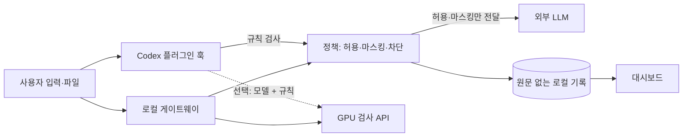

# AI PII Gateway

코디세이 AI 해커톤 2026 **프리덤** 팀의 한국어 AI 개인정보 보호 프로젝트입니다.

Codex 같은 AI 도구를 쓰다 보면 주민등록번호, 카드번호, API 키가 프롬프트나 파일 내용에 섞여 외부 LLM으로 나갈 수 있습니다. 이 프로젝트는 그런 값을 전송 전에 찾아 막고, 무엇을 막았는지 대시보드로 보여줍니다. 탐지 모델은 한국어 데이터로 GPU 서버에서 직접 파인튜닝했습니다.

| 구성 | 위치 | 역할 |
|---|---|---|
| Codex 플러그인 훅 | `dev/launcher/plugin/` | 입력과 파일·명령 결과를 전송 전에 검사하고 차단 |
| 차단 사건 대시보드 | `dev/observability/` | 멈춘 전송과 운영 현황을 브라우저에 실시간 표시 |
| 게이트웨이 | `dev/gateway/` | 요청과 응답을 모두 검사한 뒤 전달하는 로컬 프록시 |
| 검사 API | `dev/detector/` | GPU 서버에서 탐지 모델을 실행 |
| 모델 학습·평가 | `model/` | 한국어 PII 탐지 모델 학습과 평가 |



## 실행 방법

가장 빠르게 동작을 확인하는 경로입니다. **별도 설정 없이 규칙 검사 모드로 동작하며, 서버와 API 키가 필요 없습니다.**

### 1. 설치

필요한 것은 macOS, Git, [Codex CLI](https://github.com/openai/codex), `/usr/bin/python3`(Xcode 명령줄 도구)입니다. 검증한 Codex CLI 버전은 `0.166.0`입니다. Python 패키지는 설치하지 않습니다.

```zsh
git clone https://github.com/stevenkim18/2026_codyssey_freedom.git
cd 2026_codyssey_freedom
codex plugin marketplace add "$PWD"
codex plugin add pii-gateway@codyssey-security
```

### 2. 환경 설정

규칙 검사 모드는 설정이 필요 없습니다. 아래 항목은 선택 사항입니다.

| 설정 | 기본값 | 설명 |
|---|---|---|
| `~/.config/ai-pii-gateway/client.json` | 없음 | 있으면 GPU 검사 API를 함께 쓰는 모델 + 규칙 모드로 동작. [모델 + 규칙 모드](#모델--규칙-모드) 참고 |
| `PII_DASHBOARD_PORT` | `8787` | 대시보드 포트. `off`면 자동 실행을 끔 |

### 3. 실행

```zsh
codex
```

처음 실행하면 **Hooks need review** 화면이 나옵니다. **2. Trust all and continue**를 선택하세요. 승인하지 않으면 훅이 동작하지 않아 입력이 검사 없이 전송됩니다.

첫 입력에서 `PII 보호 켜짐` 표시가 나오면 정상입니다. 대시보드는 자동으로 실행되며, 표시된 주소 `http://127.0.0.1:8787`을 브라우저에서 엽니다. 그다음 가상의 값으로 시험합니다.

| 입력 예시 | Codex 동작 | 대시보드 표시 |
|---|---|---|
| `주민번호 900101-1234567 확인해줘` | 전송 차단 | 차단 |
| `메일 user@example.com 로 보내줘` | 전송을 멈추고 가린 문장 안내 | 중단 |

자동 실행을 끈 경우에는 대시보드를 직접 실행할 수 있습니다.

```zsh
cd dev
python3 -m observability
```

## 모델 + 규칙 모드

학습한 모델은 GPU 서버의 검사 API에서 실행됩니다. **모델 가중치와 검사 API 접속 정보는 이 저장소에 공개하지 않으므로**, 저장소만으로 직접 실행할 수 있는 것은 위의 규칙 검사 모드입니다. 모델 성능은 [평가 보고서](model/report_v2.md)와 아래 결과로 확인할 수 있습니다.

운영자에게 접속 정보를 받은 경우 `~/.config/ai-pii-gateway/client.json`을 권한 `0600`으로 만듭니다.

```json
{
  "detector_url": "https://검사서버:8766/v1/inspect",
  "detector_token": "운영자가 제공한 토큰",
  "detector_ca_file": "/absolute/path/detector-ca.pem"
}
```

이 설정이 있는데 검사 서버에 연결할 수 없으면 입력과 도구 결과를 차단합니다. 자세한 내용은 [플러그인 훅 가이드](docs/PLUGIN_HOOK_GUIDE.md)에 있습니다.

## 게이트웨이 경로

플러그인 훅은 응답을 화면 표시 전에 막을 수 없습니다. 응답까지 전달 전에 검사하려면 게이트웨이를 사용합니다. 이 경로는 배포 아카이브, GPU 검사 API 주소와 토큰, OpenAI API 키가 필요하며 절차는 [macOS 설치 가이드](docs/USER_INSTALLATION_GUIDE.md)에 있습니다.

필요한 환경 변수 형식은 [`dev/gateway/.env.example`](dev/gateway/.env.example)과 [`dev/detector/.env.example`](dev/detector/.env.example)에 있습니다. 실제 키와 토큰은 커밋하지 마세요.

## 직접 학습한 모델

기본 모델 `urchade/gliner_multi_pii-v1`(M0)을 K-PII-Bench 5,000건으로 대회 제공 GPU 서버(NVIDIA L4 24GB)에서 2 epoch 파인튜닝해 M1을 만들었습니다. 기본 토크나이저가 한국어 조사를 이름과 한 덩어리로 묶는 문제는 전용 분할기 `ko_atomic_suffix_v3`로 해결했고, 숫자 오탐과 마스킹 재검사 오류는 런타임 가드레일로 줄였습니다. 교체 기준 5개를 모두 통과해 최종 판정은 `replace`입니다.

| 시험 | 지표 | M0 기본 모델 | M1 파인튜닝 | M1 + 가드레일 |
|---|---|---:|---:|---:|
| 서비스 시험 300건 | 전체 F1 | 76.50% | 89.38% | **90.76%** |
| | 중요 5종 재현율 | 89.52% | 94.76% | **94.76%** |
| | 주민등록번호 재현율 | 80.00% | 97.50% | **97.50%** |
| | 주민등록번호 오탐 | 0건 | 13건 | **0건** |
| | 정상 문서 오차단 | 1/100 | 2/100 | **0/100** |
| 공식 Test 28,142건 | 전체 F1 | 66.58% | 98.70% | **98.70%** |
| | 중요 5종 재현율 | 78.67% | 99.99% | **99.99%** |

중요 5종은 주민등록번호, 계좌번호, 카드번호, 전화번호, 이메일입니다.


M1은 GPU 서버의 실제 런타임에서도 인수 시험을 통과했습니다.

| 항목 | 결과 | 기준 |
|---|---|---|
| 게이트웨이 지연 시간 p95 (동시 1건, 300건 측정) | 98.46ms | 500ms 이하 |
| 무중단 교체 M0 → M1 | 10.16초 | 교체 후 M1 활성 |
| 즉시 롤백 M1 → M0 | 11.99초 | 롤백 후 M0 활성 |
| 감사 기록의 개인정보 원문 노출 | 0건 | 0건 |

**수치를 읽을 때 주의할 점**

- 가드레일은 같은 시험의 오류를 확인한 뒤 추가했습니다. 그래서 `M1 + 가드레일` 열은 독립된 재시험 결과가 아니며, 새로운 시험셋으로 다시 검증하지는 않았습니다.
- 가드레일은 M1에만 적용했습니다. `M0`와 `M1 + 가드레일`의 차이에는 가중치 외 효과도 들어 있습니다. 가중치만의 효과는 `M0`와 `M1 파인튜닝`을 비교하세요.
- 서비스 시험은 팀이 구성하고 사람이 검토한 시나리오이고, 공식 Test는 학습 데이터와 같은 벤치마크입니다. 실제 업무 문서의 성능은 다를 수 있습니다.

학습 과정과 평가 기준은 [최종 보고서](model/report_v2.md)와 [모델 문서](model/docs/README.md)에 있습니다.

## 테스트

Python 3.12 환경에서 실행합니다. 패키지 목록은 `dev/environment.yml`에 있고, 모델 테스트에는 `numpy`가 추가로 필요합니다.

```zsh
conda env create -f dev/environment.yml
conda activate py312
pip install numpy

# 플러그인·대시보드·게이트웨이·검사 API
cd dev
python -m pytest -q

# 모델 학습·평가
cd ..
PYTHONPATH=dev:. python -m pytest --noconftest -q model/tests
```

커밋 `147082f`에서 `dev` 2,309개, `model` 214개가 통과했습니다. `dev`의 1개는 Linux 전용이라 macOS에서 건너뜁니다.

## 알려진 한계

**보호 범위**

- 현재 지원하는 도구는 Codex뿐입니다.
- 플러그인은 응답이 화면에 표시된 뒤에만 검사합니다. 대시보드는 이를 `사후`로 구분하고 차단 수에 넣지 않습니다.
- 훅은 사용자 권한으로 실행되므로 강제 통제가 아닙니다. 사용자가 승인을 끄거나 플러그인을 제거할 수 있습니다.
- 격리 환경과 모의 LLM으로 검증했습니다. 실제 ChatGPT 로그인, 실제 OpenAI 왕복, Codex 데스크톱 앱에서의 동작은 검증하지 않았습니다.

**탐지 성능**

- 규칙 모드는 대표 형식만 찾습니다. 이름은 라벨이나 호칭이 붙은 경우만 찾고, 의도적으로 숨긴 값은 찾지 못합니다.
- 모델 모드도 모두 찾지는 못합니다. 서비스 시험에서 전달된 문서에 보호 대상 17개(17/203)가 남았습니다.
- 공식 Test 28,142건 중 289건은 마스킹 후 재검사를 통과하지 못해 전송을 막았습니다.
- 직책·질병 같은 `PERSONAL_ATTRIBUTE`는 약합니다. 서비스 시험 재현율이 64.71%에서 47.06%로 낮아졌고, 학습 데이터에 해당 라벨이 없습니다.

**대시보드**

- 이 PC의 기록만 읽습니다. PRD의 중앙 사건 수집, 로그인, SSE, 오프라인 평가 표시는 구현하지 않았습니다.
- 화면의 건수는 운영 기록이며 탐지 정확도를 뜻하지 않습니다.

항목별 검증 범위는 [플러그인 훅 가이드 §7](docs/PLUGIN_HOOK_GUIDE.md)에 있습니다.

## 외부 자원

| 구분 | 명칭 | 용도 | 라이선스 |
|---|---|---|---|
| 모델 | `urchade/gliner_multi_pii-v1` | 파인튜닝 기반 모델 | Apache-2.0 |
| 모델 | `microsoft/mdeberta-v3-base` | 백본 | MIT |
| 오픈소스 | GLiNER 0.2.29 | 개체 탐지 프레임워크 | Apache-2.0 |
| 오픈소스 | PyTorch, Transformers, Accelerate, SentencePiece | 학습·추론 | BSD 계열, Apache-2.0 |
| 오픈소스 | FastAPI, Starlette, Uvicorn, Pydantic, HTTPX | 서버·통신 | MIT, BSD-3-Clause |
| 오픈소스 | pytest, Hypothesis, PyInstaller | 테스트·패키징 | MIT, MPL-2.0, GPL-2.0(예외 조항) |
| 오픈소스 | OpenAI Codex CLI | 보호 대상 CLI | Apache-2.0 |
| 외부 API | OpenAI API | 게이트웨이 경로 LLM 호출 | 상용 API |
| 데이터 | K-PII-Bench | 학습·평가 | CC BY 4.0 |
| 데이터 | `townboy/korean-pii-dataset` | 후보 검증, 미채택 | CC BY 4.0 |
| 인프라 | 네이버 클라우드 GPU 서버 | 학습·추론 | 주최 측 제공 |
| 사전 보유 코드 | 없음 | 해당 없음 | 해당 없음 |

K-PII-Bench: Woohyun Park, Jinyoung Oh, Jeong-Won Cha, Changwon National University, 2026. 변환·표본 추출하여 사용했습니다. 고정 버전과 출처는 [라이선스 문서](model/docs/08-licenses-and-provenance.md)에 있습니다.

## 문서

- [PRD](docs/AI_PII_Gateway_PRD_v1.md): 요구사항과 설계
- [플러그인 훅 가이드](docs/PLUGIN_HOOK_GUIDE.md): 보호 범위, 탐지 규칙, 실패 시 동작
- [대시보드 문서](dev/observability/README.md): 판정 기준과 운영 현황
- [macOS 설치 가이드](docs/USER_INSTALLATION_GUIDE.md): 게이트웨이 경로
- [모델 문서](model/docs/README.md): 학습, 평가, 문제 해결 기록

## 팀 프리덤

| 이름 | 담당 |
|---|---|
| 이진걸 | 모델 학습·평가, 런타임 통합 |
| 주재문 | 게이트웨이, 검사 API, 배포 |
| 김승우 | 대시보드, 문서화 |

Codex 플러그인은 세 명이 함께 작업했습니다.
