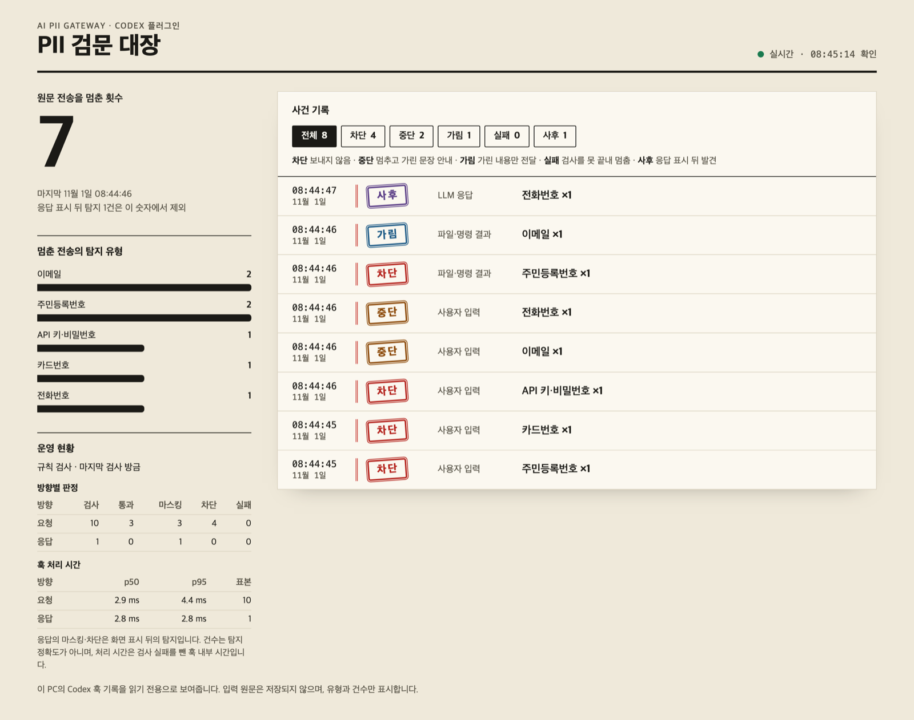
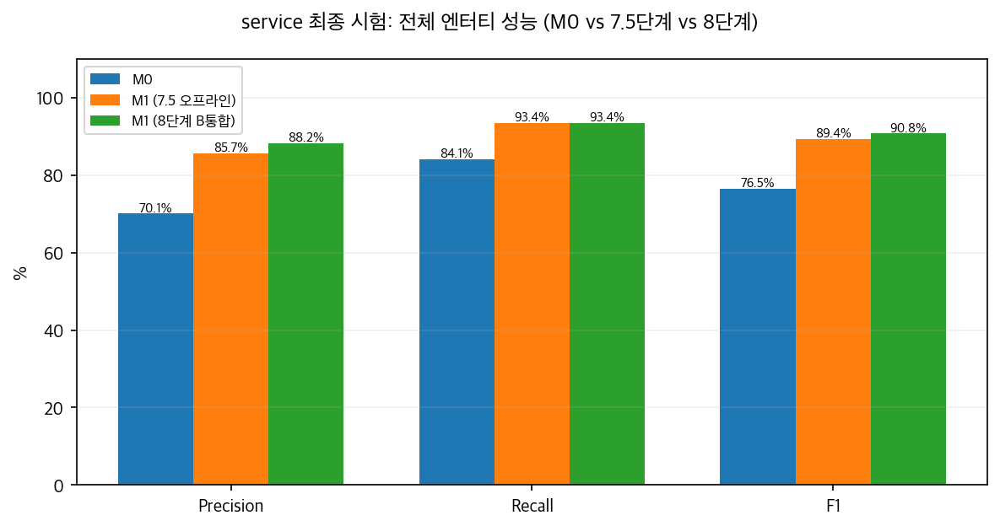
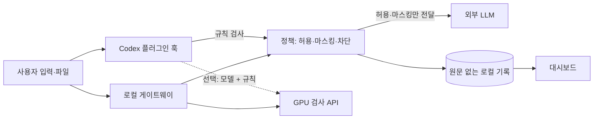

<div align="center">

# AI PII Gateway

<h3><b>"AI 사용을 막지 않으면서, 나가면 안 되는 정보만 멈춰 세웁니다."</b></h3>

<p>
  프롬프트와 파일 속 개인정보를 <b>외부 LLM으로 나가기 전에</b> 찾아 막고,<br/>
  한국어 데이터로 <b>직접 학습한 모델</b>로 탐지하며,<br/>
  무엇을 막았는지 <b>원문 없이</b> 대시보드로 보여줍니다.
</p>

[🚀 실행 방법](#-실행-방법) • [🧠 모델 성능](#-직접-학습한-모델) • [🧱 시스템 구조](#-시스템-구조) • [📑 최종 보고서](model/report_v2.md)

</div>

---

## 목차

- [📋 개요](#-개요)
- [👥 팀원](#-팀원)
- [💡 소개](#-소개)
- [🌊 핵심 서비스 흐름](#-핵심-서비스-흐름)
- [📸 화면](#-화면)
- [🚀 실행 방법](#-실행-방법)
- [🧠 직접 학습한 모델](#-직접-학습한-모델)
- [🧱 시스템 구조](#-시스템-구조)
- [🧰 기술 스택](#-기술-스택)
- [🧪 테스트](#-테스트)
- [🚧 알려진 한계](#-알려진-한계)
- [📦 외부 자원](#-외부-자원)
- [📜 문서](#-문서)

## 📋 개요

- **대회**: 코디세이 AI 해커톤 2026 (주최: 이노베이션아카데미)
- **주제**: AI 기반 정보보호 서비스
- **개발 기간**: 2026.10.30(금) ~ 11.1(일)
- **팀 구성**: 프리덤, 3명 (모델, 게이트웨이·배포, 대시보드)
- **프로젝트 규모**: Codex 플러그인, 로컬 게이트웨이, GPU 검사 API, 로컬 대시보드, 모델 학습·평가

## 👥 팀원

<table>
<tr>
<td align="center" width="33%">
<a href="https://github.com/I-nkamanda">
<br />
<sub><b>이진걸 @I-nkamanda</b></sub>
</a>
</td>
<td align="center" width="33%">
<a href="https://github.com/OliverJoo">
<br />
<sub><b>주재문 @OliverJoo</b></sub>
</a>
</td>
<td align="center" width="33%">
<a href="https://github.com/stevenkim18">
<br />
<sub><b>김승우 @stevenkim18</b></sub>
</a>
</td>
</tr>
<tr>
<td align="center">모델 학습·평가<br/>한국어 분할기, GPU 파인튜닝<br/>런타임 통합</td>
<td align="center">게이트웨이, 검사 API<br/>GPU API 배포와 TLS<br/>Mac 배포 패키지, 통합 검증</td>
<td align="center">차단 사건 대시보드<br/>운영 현황 시각화<br/>프로젝트 문서화</td>
</tr>
</table>

Codex 플러그인은 세 명이 함께 작업했습니다.

## 💡 소개

### **"서버에서 나오는 경고는 이미 보낸 다음입니다"**

개발자는 코드와 로그, 고객 데이터를 프롬프트에 그대로 붙여 넣습니다. 그 안에 주민등록번호나 카드번호, API 키가 섞여 있어도 서버 쪽 경고가 나올 때면 데이터는 이미 전달된 뒤입니다. 회사에는 AI를 금지하거나 위험을 감수하는 두 가지 선택만 남습니다.

한국어 데이터에서는 문제가 더 커집니다. 기본 다국어 PII 모델은 공식 벤치마크에서 주민등록번호를 **28.16%** 만 찾았습니다.

### 해결 방안

#### **"막지 않고, 전송 전에 걸러냅니다."**

- **전송 전 검사**: 입력과 파일·명령 결과를 LLM으로 보내기 전에 검사합니다.
- **쓰던 도구 그대로**: Codex에 플러그인만 설치하면 됩니다. 서버와 API 키 없이 시작할 수 있습니다.
- **한국어 특화 모델**: 조사가 붙은 이름과 주민등록번호를 찾도록 GPU 서버에서 직접 파인튜닝했습니다.
- **원문 없는 기록**: 유형과 조치만 남겨 기록 자체가 새로운 유출 지점이 되지 않게 합니다.

### 핵심 가치

**개발자**
쓰던 Codex 그대로, 실수로 붙여 넣은 값만 멈춥니다.

**보안 담당자**
어떤 유형이 얼마나 멈췄는지 원문을 보지 않고 확인합니다.

**회사**
전면 금지와 위험 감수 사이의 세 번째 선택지를 얻습니다.

## 🌊 핵심 서비스 흐름

#### **1. Inspect (전송 전 검사)**

- 사용자 입력과 파일·명령 결과가 LLM으로 가기 전에 플러그인 훅이 먼저 받습니다.
- 규칙 엔진이 PC에서 바로 검사하고, 설정하면 GPU 검사 API의 모델도 함께 씁니다.
- 게이트웨이 경로는 LLM 응답도 화면에 표시하기 전에 검사합니다.

#### **2. Decide (정책 판정)**

| 판정 | 대상 | 동작 |
|---|---|---|
| 차단 | 주민등록번호, 카드번호, API 키, 개인 키 | 보내지 않고 값을 지워 달라고 안내 |
| 마스킹 | 이름, 이메일, 전화번호, 계좌번호, 주소 등 | 값을 `[REDACTED]`로 가린 문장을 안내 |
| 허용 | 그 외 내용 | 그대로 전달 |
| 실패 | 검사를 끝내지 못한 경우 | 내용을 보내지 않음 |

Codex 화면에는 이렇게 표시됩니다.

```text
전송을 막았습니다: 주민등록번호 1건. 해당 값을 지우고 다시 입력해 주세요.
```

```text
개인정보가 있어 전송을 멈췄습니다 (이메일 1건).
아래 문장으로 다시 보내 주세요.

메일 [REDACTED] 로 보내줘
```

#### **3. Record (기록과 시각화)**

- 검사 결과는 원문 없이 유형, 건수, 규칙, 시각만 이 PC에 기록합니다.
- 대시보드가 그 기록을 읽기 전용으로 읽어 브라우저에 실시간으로 보여줍니다.

## 📸 화면

### 차단 사건 대시보드



실제 플러그인 훅에 가상의 값을 넣어 만든 기록입니다. 화면에는 값 자체가 나오지 않습니다.

## 🚀 실행 방법

가장 빠르게 동작을 확인하는 경로입니다.

> [!NOTE]
> **별도 설정 없이 규칙 검사 모드로 동작하며, 서버와 API 키가 필요 없습니다.**
>
> 모델 가중치와 검사 API 접속 정보는 공개하지 않습니다. 모델 성능은 [직접 학습한 모델](#-직접-학습한-모델)과 [최종 보고서](model/report_v2.md)에서 확인할 수 있습니다.

### 1. 설치

필요한 것은 macOS, Git, [Codex CLI](https://github.com/openai/codex), `/usr/bin/python3`(Xcode 명령줄 도구)입니다. 검증한 Codex CLI 버전은 `0.166.0`입니다. Python 패키지는 설치하지 않습니다.

```zsh
git clone https://github.com/stevenkim18/2026_codyssey_freedom.git
cd 2026_codyssey_freedom
codex plugin marketplace add "$PWD"
codex plugin add pii-gateway@codyssey-security
```

### 2. 환경 설정

규칙 검사 모드는 설정이 필요 없습니다. 아래 항목은 선택 사항입니다.

| 설정 | 기본값 | 설명 |
|---|---|---|
| `~/.config/ai-pii-gateway/client.json` | 없음 | 있으면 GPU 검사 API를 함께 쓰는 모델 + 규칙 모드로 동작. [모델 + 규칙 모드](#모델--규칙-모드) 참고 |
| `PII_DASHBOARD_PORT` | `8787` | 대시보드 포트. `off`면 자동 실행을 끔 |

### 3. 실행

```zsh
codex
```

처음 실행하면 **Hooks need review** 화면이 나옵니다. **2. Trust all and continue**를 선택하세요. 승인하지 않으면 훅이 동작하지 않아 입력이 검사 없이 전송됩니다.

첫 입력에서 `PII 보호 켜짐` 표시가 나오면 정상입니다. 대시보드는 자동으로 실행되며, 표시된 주소 `http://127.0.0.1:8787`을 브라우저에서 엽니다. 그다음 가상의 값으로 시험합니다.

| 입력 예시 | Codex 동작 | 대시보드 표시 |
|---|---|---|
| `주민번호 900101-1234567 확인해줘` | 전송 차단 | 차단 |
| `메일 user@example.com 로 보내줘` | 전송을 멈추고 가린 문장 안내 | 중단 |

자동 실행을 끈 경우에는 대시보드를 직접 실행할 수 있습니다.

```zsh
cd dev
python3 -m observability
```

### 모델 + 규칙 모드

학습한 모델은 GPU 서버의 검사 API에서 실행합니다. 운영자에게 접속 정보를 받은 경우 `~/.config/ai-pii-gateway/client.json`을 권한 `0600`으로 만듭니다.

```json
{
  "detector_url": "https://검사서버:8766/v1/inspect",
  "detector_token": "운영자가 제공한 토큰",
  "detector_ca_file": "/absolute/path/detector-ca.pem"
}
```

이 설정이 있는데 검사 서버에 연결할 수 없으면 입력과 도구 결과를 차단합니다. 자세한 내용은 [플러그인 훅 가이드](docs/PLUGIN_HOOK_GUIDE.md)에 있습니다.

### 게이트웨이 경로

플러그인 훅은 응답을 화면 표시 전에 막을 수 없습니다. 응답까지 전달 전에 검사하려면 게이트웨이를 사용합니다. 이 경로는 배포 아카이브, GPU 검사 API 주소와 토큰, OpenAI API 키가 필요하며 절차는 [macOS 설치 가이드](docs/USER_INSTALLATION_GUIDE.md)에 있습니다.

필요한 환경 변수 형식은 [`dev/gateway/.env.example`](dev/gateway/.env.example)과 [`dev/detector/.env.example`](dev/detector/.env.example)에 있습니다. 실제 키와 토큰은 커밋하지 마세요.

## 🧠 직접 학습한 모델

기본 모델 `urchade/gliner_multi_pii-v1`(M0)을 K-PII-Bench 5,000건으로 대회 제공 GPU 서버(NVIDIA L4 24GB)에서 2 epoch 파인튜닝해 M1을 만들었습니다. 기본 토크나이저가 한국어 조사를 이름과 한 덩어리로 묶는 문제는 전용 분할기 `ko_atomic_suffix_v3`로 해결했고, 숫자 오탐과 마스킹 재검사 오류는 런타임 가드레일로 줄였습니다. 교체 기준 5개를 모두 통과해 최종 판정은 `replace`입니다.

| 시험 | 지표 | M0 기본 모델 | M1 파인튜닝 | M1 + 가드레일 |
|---|---|---:|---:|---:|
| 서비스 시험 300건 | 전체 F1 | 76.50% | 89.38% | **90.76%** |
| | 중요 5종 재현율 | 89.52% | 94.76% | **94.76%** |
| | 주민등록번호 재현율 | 80.00% | 97.50% | **97.50%** |
| | 주민등록번호 오탐 | 0건 | 13건 | **0건** |
| | 정상 문서 오차단 | 1/100 | 2/100 | **0/100** |
| 공식 Test 28,142건 | 전체 F1 | 66.58% | 98.70% | **98.70%** |
| | 중요 5종 재현율 | 78.67% | 99.99% | **99.99%** |

중요 5종은 주민등록번호, 계좌번호, 카드번호, 전화번호, 이메일입니다.



M1은 GPU 서버의 실제 런타임에서도 인수 시험을 통과했습니다.

| 항목 | 결과 | 기준 |
|---|---|---|
| 게이트웨이 지연 시간 p95 (동시 1건, 300건 측정) | 98.46ms | 500ms 이하 |
| 무중단 교체 M0 → M1 | 10.16초 | 교체 후 M1 활성 |
| 즉시 롤백 M1 → M0 | 11.99초 | 롤백 후 M0 활성 |
| 감사 기록의 개인정보 원문 노출 | 0건 | 0건 |

> [!IMPORTANT]
> **수치를 읽을 때 주의할 점**
>
> - 가드레일은 같은 시험의 오류를 확인한 뒤 추가했습니다. 그래서 `M1 + 가드레일` 열은 독립된 재시험 결과가 아니며, 새로운 시험셋으로 다시 검증하지는 않았습니다.
> - 가드레일은 M1에만 적용했습니다. `M0`와 `M1 + 가드레일`의 차이에는 가중치 외 효과도 들어 있습니다. 가중치만의 효과는 `M0`와 `M1 파인튜닝`을 비교하세요.
> - 서비스 시험은 팀이 구성하고 사람이 검토한 시나리오이고, 공식 Test는 학습 데이터와 같은 벤치마크입니다. 실제 업무 문서의 성능은 다를 수 있습니다.

학습 과정과 평가 기준은 [최종 보고서](model/report_v2.md)와 [모델 문서](model/docs/README.md)에 있습니다.

## 🧱 시스템 구조



| 구성 | 위치 | 역할 |
|---|---|---|
| Codex 플러그인 훅 | `dev/launcher/plugin/` | 입력과 파일·명령 결과를 전송 전에 검사하고 차단 |
| 차단 사건 대시보드 | `dev/observability/` | 멈춘 전송과 운영 현황을 브라우저에 실시간 표시 |
| 게이트웨이 | `dev/gateway/` | 요청과 응답을 모두 검사한 뒤 전달하는 로컬 프록시 |
| 검사 API | `dev/detector/` | GPU 서버에서 탐지 모델을 실행 |
| 모델 학습·평가 | `model/` | 한국어 PII 탐지 모델 학습과 평가 |

- 플러그인과 게이트웨이는 같은 정책 코드를 씁니다. 그래서 연결 방식이 달라도 판정 기준은 같습니다.
- 무거운 모델은 GPU 서버에, 전송을 막는 가벼운 계층은 사용자 PC에 두었습니다.
- 모델 패키지는 서비스를 멈추지 않고 교체하고 되돌릴 수 있습니다.
- 대시보드는 플러그인 훅이 남긴 기록을 읽습니다.

## 🧰 기술 스택

| 영역 | 카테고리 | 기술 스택 | 설명 |
|---|---|---|---|
| **AI·학습** | 언어 | Python 3.12 | 전체 공통 |
| | 프레임워크 | PyTorch 2.10, Transformers 4.57 | 학습·추론 |
| | 개체 탐지 | GLiNER 0.2.29 | PII 스팬 탐지와 파인튜닝 |
| | 전처리 | `ko_atomic_suffix_v3` | 직접 만든 한국어 조사 분할기 |
| **서버** | API | FastAPI, Uvicorn, Pydantic | 검사 API, 로컬 게이트웨이 |
| | 통신 | HTTPX, HTTPS 토큰 인증 | 검사 서버 연결 |
| | 저장 | SQLite | 원문 없는 사건 기록 |
| **사용자 PC** | 연동 | Codex 플러그인 훅 | 전송 전 검사 |
| | 대시보드 | Python 표준 라이브러리 | 추가 설치 없이 실행 |
| | 배포 | PyInstaller | Mac 독립 패키지 |
| **인프라** | GPU | NVIDIA L4 24GB, Ubuntu 24.04 | 주최 측 제공 서버 |
| | 프로세스 관리 | systemd | 검사 API 운영 |
| **품질** | 테스트 | pytest, Hypothesis | 회귀·악조건 테스트 |

## 🧪 테스트

Python 3.12 환경에서 실행합니다. 패키지 목록은 `dev/environment.yml`에 있고, 모델 테스트에는 `numpy`가 추가로 필요합니다.

```zsh
conda env create -f dev/environment.yml
conda activate py312
pip install numpy

# 플러그인·대시보드·게이트웨이·검사 API
cd dev
python -m pytest -q

# 모델 학습·평가
cd ..
PYTHONPATH=dev:. python -m pytest --noconftest -q model/tests
```

커밋 `147082f`에서 `dev` 2,309개, `model` 214개가 통과했습니다. `dev`의 1개는 Linux 전용이라 macOS에서 건너뜁니다.

## 🚧 알려진 한계

**보호 범위**

- 현재 지원하는 도구는 Codex뿐입니다.
- 플러그인은 응답이 화면에 표시된 뒤에만 검사합니다. 대시보드는 이를 `사후`로 구분하고 차단 수에 넣지 않습니다.
- 훅은 사용자 권한으로 실행되므로 강제 통제가 아닙니다. 사용자가 승인을 끄거나 플러그인을 제거할 수 있습니다.
- 격리 환경과 모의 LLM으로 검증했습니다. 실제 ChatGPT 로그인, 실제 OpenAI 왕복, Codex 데스크톱 앱에서의 동작은 검증하지 않았습니다.

**탐지 성능**

- 규칙 모드는 대표 형식만 찾습니다. 이름은 라벨이나 호칭이 붙은 경우만 찾고, 의도적으로 숨긴 값은 찾지 못합니다.
- 모델 모드도 모두 찾지는 못합니다. 서비스 시험에서 전달된 문서에 보호 대상 17개(17/203)가 남았습니다.
- 공식 Test 28,142건 중 289건은 마스킹 후 재검사를 통과하지 못해 전송을 막았습니다.
- 직책·질병 같은 `PERSONAL_ATTRIBUTE`는 약합니다. 서비스 시험 재현율이 64.71%에서 47.06%로 낮아졌고, 학습 데이터에 해당 라벨이 없습니다.

**대시보드**

- 이 PC의 기록만 읽습니다. PRD의 중앙 사건 수집, 로그인, SSE, 오프라인 평가 표시는 구현하지 않았습니다.
- 화면의 건수는 운영 기록이며 탐지 정확도를 뜻하지 않습니다.

항목별 검증 범위는 [플러그인 훅 가이드 §7](docs/PLUGIN_HOOK_GUIDE.md)에 있습니다.

## 📦 외부 자원

| 구분 | 명칭 | 용도 | 라이선스 |
|---|---|---|---|
| 모델 | `urchade/gliner_multi_pii-v1` | 파인튜닝 기반 모델 | Apache-2.0 |
| 모델 | `microsoft/mdeberta-v3-base` | 백본 | MIT |
| 오픈소스 | GLiNER 0.2.29 | 개체 탐지 프레임워크 | Apache-2.0 |
| 오픈소스 | PyTorch, Transformers, Accelerate, SentencePiece | 학습·추론 | BSD 계열, Apache-2.0 |
| 오픈소스 | FastAPI, Starlette, Uvicorn, Pydantic, HTTPX | 서버·통신 | MIT, BSD-3-Clause |
| 오픈소스 | pytest, Hypothesis, PyInstaller | 테스트·패키징 | MIT, MPL-2.0, GPL-2.0(예외 조항) |
| 오픈소스 | OpenAI Codex CLI | 보호 대상 CLI | Apache-2.0 |
| 외부 API | OpenAI API | 게이트웨이 경로 LLM 호출 | 상용 API |
| 데이터 | K-PII-Bench | 학습·평가 | CC BY 4.0 |
| 데이터 | `townboy/korean-pii-dataset` | 후보 검증, 미채택 | CC BY 4.0 |
| 인프라 | 네이버 클라우드 GPU 서버 | 학습·추론 | 주최 측 제공 |
| 사전 보유 코드 | 없음 | 해당 없음 | 해당 없음 |

K-PII-Bench: Woohyun Park, Jinyoung Oh, Jeong-Won Cha, Changwon National University, 2026. 변환·표본 추출하여 사용했습니다. 고정 버전과 출처는 [라이선스 문서](model/docs/08-licenses-and-provenance.md)에 있습니다.

## 📜 문서

- [PRD](docs/AI_PII_Gateway_PRD_v1.md): 요구사항과 설계
- [플러그인 훅 가이드](docs/PLUGIN_HOOK_GUIDE.md): 보호 범위, 탐지 규칙, 실패 시 동작
- [대시보드 문서](dev/observability/README.md): 판정 기준과 운영 현황
- [macOS 설치 가이드](docs/USER_INSTALLATION_GUIDE.md): 게이트웨이 경로
- [모델 문서](model/docs/README.md): 학습, 평가, 문제 해결 기록
