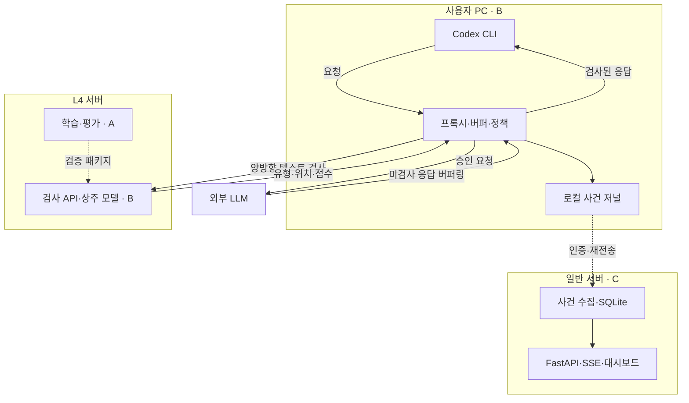

# PRD — 한국어 AI 양방향 개인정보 보호 게이트웨이

버전 1.0 · 2026-10-31 · 구현·TDD 기준 문서

## 1. 제품 결정

사용자 PC의 경량 프록시가 CLI 요청과 LLM 응답을 전달 전에 검사한다. L4 서버는 개인정보 탐지, 일반 서버는 사건 수집·FastAPI 대시보드를 담당한다. 기존 모델로 전체 경로를 먼저 완성하고, 한국어 추가 학습 모델이 교체 기준을 통과하면 적용한다.

- 우선순위: P0 양방향 통제·사건 조회 → P1 한국어 성능 개선·지연 최적화 → P2 배포 환경 확대.
- 보장 범위: 프록시를 통과하는 지원 텍스트의 검사·정책 집행. 모든 개인정보의 탐지나 법적 컴플라이언스를 보장하지 않는다.
- 신뢰 범위: 사용자 PC + 팀의 GPU 검사 서버. 원문은 GPU 서버로 전송되며 외부 생성형 LLM으로는 정책 승인 후 전달된다.
- Assumption: 단일 팀·소수 사용자, 텍스트 중심 시연. 실제 개발 기간·GPU 호스트 CPU/RAM·리전·인증 정보는 미확정이다. 수치는 별도 표기가 없으면 제안 설정이며 성능 실측값이 아니다.

## 2. 범위와 사용자 흐름

| 포함(P0) | 제외 |
|---|---|
| 고정 버전 Codex CLI, OpenAI API 키 인증 | ChatGPT 웹·공식 앱, 구독 인증 우회 |
| 요청·응답 개인정보 검사, 허용·마스킹·차단 | 도구 실행·MCP·첨부·음성·이미지 |
| 전체 응답 검사 후 CLI 전달 | 원본 스트림 선전달, 문장 단위 조기 전달 |
| 로그·실시간 대시보드·모델 버전 비교 | 승인 버튼으로 재개, 원문 복원, 온라인 자동 학습 |
| 패턴 기반 비밀키 탐지 보조 | 일반 프롬프트 인젝션·기업 기밀·법률 준수 판정 |

사용자: 설치 → 연결·보호 상태 확인 → CLI 입력 → 요청 검사 → 승인된 요청만 외부 API 호출 → 응답 버퍼링·검사 → 승인된 결과 표시 → 대시보드에서 사건 확인.

검사는 제출 텍스트뿐 아니라 지원하는 요청의 instructions·대화 이력·입력 텍스트 전체를 포함한다. 직접 통신·다른 CLI·로컬 입력 기록은 보호 범위 밖이다. 도구 정의가 불가피한 CLI라면 지원하지 않는 도구 출력은 전달 전에 차단하고, 자동 실행은 비활성화한다.

## 3. 배치와 소유권

| 위치 | 기능 | 소유자 |
|---|---|---|
| 사용자 PC | CLI 어댑터·정책·마스킹·응답 버퍼·로컬 사건 저널·설치 셸 | B |
| gp1l4-g3, L4 24GB | 검사 API·모델 로딩·상주 추론·규칙 탐지 | B |
| 동일 GPU, 별도 시간대 | 데이터 변환·파인튜닝·오프라인 평가 | A |
| s2-g3, 2 vCPU/8GB | 사건 API·SQLite·조회·SSE·웹 화면 | C |

일반 서버는 검사 요청의 중계 경로에 넣지 않는다. GPU 학습·실시간 추론은 시간 분리한다. 모델과 운영 추론 코드를 A·B가 중복 구현하지 않는다.

## 4. A·B·C 작업 경계

| 담당 | 단독 책임·산출물 | 비담당 |
|---|---|---|
| A | 데이터 검증·변환, 학습, 기준선/후보 평가, 라벨·임계값, 모델 패키지·평가 보고서 | 운영 추론 API·프록시·UI |
| B | 기존 모델 실행부터 교체까지, 검사 API, 요청/응답 어댑터, 정책·마스킹·비밀키 규칙, 저널·전송, 설치·통합 테스트 | 학습 데이터·학습 코드·대시보드 |
| C | 사건 계약, 수집 API·중복 제거·DB, 조회/SSE·화면, 보관·접근 통제·복구 테스트 | 모델 호출·전송 승인 |

- A는 학습용 배치 평가 코드를 작성하되 운영 서버는 만들지 않는다.
- B는 모델 계약, C는 사건 계약의 관리 책임자다. 최초 합의 이후 파괴적 변경은 버전 상승·계약 테스트를 요구한다.
- 저장소: A owns training/, evaluation/; B owns gateway/, detector/, launcher/, integration/; C owns observability/. contracts/는 파일별 책임자를 명시한다.
- 기여 시간은 실제 작업 시간으로 기록한다. GPU 학습 대기 시간을 개발 시간과 혼동하지 않는다. A는 대기 중 독립 평가셋·오류 분석, C는 화면 외 수집·복구까지 담당한다.

## 5. 기능 요구사항

| ID | 요구사항 | 담당 |
|---|---|---|
| R01 | 보호 전용 CLI 프로필·API 인증·허용 목적지 설정. 설치 전 설정 백업, 제거 시 복구 | B |
| R02 | 요청 전체 파싱·지원 필드 추출. 미지원 콘텐츠·해석 불가 필드·한도 초과는 사유와 함께 거절 | B |
| R03 | 모델+규칙으로 전 구간 검사. 유형·원문 위치·점수·버전 반환. 부분 검사와 정상 무탐지를 구분 | B |
| R04 | 정책 우선순위 차단 > 마스킹 > 허용. 마스킹 충돌 범위 병합·뒤쪽부터 치환·최종 텍스트 재검사 | B |
| R05 | 응답 전체를 제한된 메모리에 버퍼링. 검사 전 내용 델타·도구 인자·원문 오류를 CLI에 보내지 않음 | B |
| R06 | 검사/정책/프로토콜 오류는 fail-closed. 타임아웃·취소·중복·불명확한 외부 전송 상태 처리 | B |
| R07 | K-PII-Bench 학습·독립 평가, 버전 패키지 전달. 통과한 후보만 교체 | A/B |
| R08 | 원문 없는 사건 저널·인증 전송·중복 제거·재시작 복구 | B/C |
| R09 | 실시간 목록·필터·상세·집계·모델 버전·지연·연결 상태 표시 | C |
| R10 | TLS·인증·권한·비밀정보 관리·보관 제한·접근 실패 처리 | B/C |
| R11 | 모델 상주·예열·대기열 제한·구간별 계측·학습/추론 시간 분리 | A/B/C |
| R12 | 모의 서버 기반 TDD·실제 CLI 검증·설치/롤백·시연 증거 | A/B/C |

### 기본 정책

| 탐지 유형 | 요청·응답 처리 |
|---|---|
| KR_RRN, CREDIT_CARD, 규칙이 확인한 API_KEY/PRIVATE_KEY | 차단 |
| PERSON, EMAIL_ADDRESS, KR_PHONE_NUMBER, KR_BANK_ACCOUNT, KR_LOCATION, DATE_OF_BIRTH | 마스킹 |
| KR_DRIVER_LICENSE, KR_PASSPORT, KR_NHIS, KR_VEHICLE_PLATE, USERNAME, PERSONAL_ATTRIBUTE | 마스킹 |
| ORGANIZATION, URL, IP_ADDRESS, NRP | 탐지 기록·경고 후 허용 |
| 미지의 유형·손상된 탐지 위치·불완전 검사 | 오류로 차단 |

위험 유형·정책은 제품 설정이지 법률 판단이 아니다. URL·기관명 탐지를 곧 개인정보 유출로 집계하지 않는다. 미탐 가능성은 남으며 재검사도 완전 보호를 보장하지 않는다. 재검사 후 잔존하면 반복 치환하지 않고 차단한다.

## 6. 모델·학습 명세

### 지정 자산

- 초기 모델 M0: **urchade/gliner_multi_pii-v1**. B가 즉시 통합한다. 모델 카드상 Apache-2.0, 한국어 서비스 성능은 직접 평가한다.[S1]
- 후보 M1: **M0를 K-PII-Bench로 추가 학습한 동일 GLiNER 계열**. 다른 기본 모델로의 교체는 MVP 이후 별도 실험이다.
- 데이터: **woohyun212/k-pii-bench**. 공개 카드 기준 합성 한국어 300,000건·12개 도메인·18개 유형, train 243,711 / dev 28,147 / test_track_a 28,142; 데이터 CC BY 4.0 표기.[S2]
- 개발 착수 시 모델·데이터 리비전, 라이브러리 버전, 라이선스 사본을 잠근다. 모델/데이터 고지와 수정 이력을 배포물에 포함한다.
- 범용 생성 LLM을 탐지기로 호출하지 않는다. 비밀키는 별도 규칙이며 K-PII-Bench 학습 성과로 주장하지 않는다.

### A의 학습 순서

1. 원문 entities의 시작·끝·문자열 일치, 중복, 라벨 분포, 템플릿 분할 중복을 검증한다.
2. 기존 BIO를 그대로 사용하지 않는다. 원문 문자 스팬을 고정 GLiNER 버전의 토큰/스팬 형식으로 변환한다. 특수문자·조사·공백 경계를 테스트한다.
3. 공통 라벨↔모델 라벨·설명 매핑을 고정한다. text만 학습 입력으로 사용하고 정답 포함 template_text·메타데이터는 제외한다.
4. train에서 도메인·유형을 고려한 5,000건으로 시험 학습, 필요 시 10,000건 이상으로 확대한다. batch=1부터 메모리 실측, gradient accumulation으로 조정한다.
5. 초기 탐색: 1~3 epoch, 학습률 1e-5~5e-5. 최종 선택은 dev 결과로 한다. 입력 길이·스팬 최대 길이는 모델 설정에 맞추며 무음 잘라내기를 금지한다.
6. dev로 임계값·체크포인트 선택; 시험셋은 최종 평가에만 사용한다. 증강본은 원본과 동일 분할에 둔다.
7. 별도 서비스 시험셋 300건을 학습 전 고정한다: 요청/응답 각각 150건, 총 정상 음성 사례 100건 이상. 표·JSON·코드·조사·긴 문서·혼합 언어·분할 경계 포함. 중요 유형별 정답 엔터티 30개 이상 확보한다.
8. 기존 모델·후보를 같은 조건에서 평가한다. 모델 단독과 동일 규칙 결합 결과를 각각 보고한다.

데이터는 공식 템플릿 분리를 유지한다. 공식 BIO 평가기를 쓸 때 예측 문자 스팬을 정답 토큰 기준으로 정렬한다. 자체 문자 스팬 평가 결과와 공식 지표를 혼용하지 않는다.[S3]

### 교체 기준

- 중요 유형: KR_RRN, KR_BANK_ACCOUNT, CREDIT_CARD, KR_PHONE_NUMBER, EMAIL_ADDRESS.
- 서비스 시험셋의 중요 유형 합산 재현율이 기준선 이상, 정상 문장 오차단율 증가가 1%p 이하, 전체 엔터티 F1이 기준선 이상이어야 한다.
- 중요 유형별 미탐 건수·분모·변화와 신뢰구간을 보고한다. 합산 개선으로 특정 유형의 악화를 숨기지 않는다. 유형별 퇴행은 원인 해소 전 교체 보류한다.
- 운영 지연·메모리 한도와 TDD 통합 테스트 통과가 필수다. 기준 미달은 M0 유지; 성능 개선을 주장하지 않는다.
- 패키지: 가중치, 모델 설정, 토크나이저, 라벨 매핑, 임계값, 전처리 규격, 버전·SHA-256·라이선스, 평가 결과, 합성 회귀 사례.
- B는 진행 요청 종료 → 새 모델 로딩·예열 → readiness 확인 → 서비스 재개. 실패 시 이전 패키지로 복귀한다. 요청 처리 중 버전을 섞지 않는다.

## 7. 인터페이스 계약

### 검사 API — B 소유

POST /v1/inspect, 인증 필수. 요청은 schema_version, request_id, inspection_id, direction(outbound/inbound), segments[{segment_id,text}]. 응답은 status(complete/incomplete/error), findings[{segment_id,type,start,end,score,detector}], model_version, threshold_version, timing_ms.

- start/end는 원문 Unicode 코드포인트, 끝 제외. 원문 정규화 시 위치 복원 필수; JS UTF-16과 직접 혼용 금지.
- 완료 응답만 정책 판단에 사용한다. 실패 응답을 빈 findings로 변환하지 않는다.
- B의 어댑터만 segment_id↔프로토콜 필드 위치를 보유한다. 모델은 전송 여부를 결정하지 않는다.
- POST 오류: 400 형식, 401/403 인증, 413 한도, 429 과부하, 503 준비 안 됨, 504 검사 시간 초과. CLI 오류 변환은 별도 어댑터 책임이다.

### 사건 API — C 소유

POST /v1/events/batch, GET /v1/events, GET /v1/events/{event_id}, GET /v1/summary, GET /v1/events/stream(SSE).

필수 필드: schema_version, event_id, client_id, session_id, request_id, inspection_id, revision, occurred_at(UTC), direction, stage, decision, delivery_status, findings[{type,count}], rule_ids, model_version, policy_version, timing_ms, error_code.

- decision: allow/mask/block/error; delivery_status: not_sent/forwarded_sanitized/forwarded_original/delivered/unknown.
- 판단 이벤트와 전달 결과 이벤트는 별도 event_id, 동일 request_id로 연결한다. 차단 결정을 전달 성공으로 간주하지 않는다.
- event_id 중복은 재삽입하지 않는다. 사건 수는 request/direction 기준, 탐지 수는 findings 기준으로 별도 집계한다.
- SSE는 증가하는 서버 cursor로 재개한다. 보관 범위를 벗어나면 snapshot 재조회 지시; 무한 메모리 대기열 금지.
- 동일 검사 재시도는 inspection_id 유지. 외부 LLM 요청 재전송은 자동 수행하지 않는다.

## 8. 프로토콜·실패 처리

Codex는 사용자 지정 base_url과 Responses 프로토콜을 지원한다.[S4] 지원 CLI 버전·모델 ID·인증·전송 방식은 첫 게이트에서 고정한다. API 구독과 ChatGPT 구독을 동일하게 취급하지 않는다.

- MVP는 HTTP/SSE 경로. WebSocket·별도 compaction·서버 저장 이력 참조는 지원 검증 전 차단한다. previous_response_id 등 원문을 검사할 수 없는 상태 참조도 기본 거절한다.
- 메타데이터는 키·타입·길이 허용목록으로 관리한다. 임의 문자열 필드를 검사 없이 외부로 전달하지 않는다. 전체 JSON에 정규식 치환을 적용하지 않는다.
- 출력 이벤트를 완성 응답으로 조립·검사한 후, 지원 스키마에 맞는 정제된 최종 객체와 SSE를 재구성한다. 델타·완료 객체 양쪽에 원문이 남지 않아야 한다.
- 사용자 취소 시 외부 호출 취소를 시도하고 늦게 도착한 결과를 폐기한다. 취소가 서버의 이미 진행된 처리를 되돌린다고 주장하지 않는다.
- 1차 마스킹 후 최종 텍스트 1회 재검사. 검사 실패·잔존·마스킹 충돌·알 수 없는 출력은 차단한다.
- 외부 오류는 허용된 코드·요약만 노출한다. 외부 오류 본문에 원문이 포함될 수 있으므로 그대로 전달·기록하지 않는다.
- 연결이 끊겨 전달 여부를 알 수 없으면 unknown 기록; 성공·차단으로 추정하지 않는다.
- 보호 프록시가 꺼지면 CLI가 직접 외부 공급자로 우회하지 않게 전용 프로필을 사용한다. 이는 악의적인 사용자 우회 방지용 네트워크 강제 통제가 아니다.

## 9. 대시보드·로그·보안

화면은 세 개로 제한한다.

| 화면 | 필수 정보 |
|---|---|
| 사건 목록 | 시각·방향·유형·정책·전달 상태, 필터·페이지 조회 |
| 사건 상세 | 유형·횟수·규칙·모델 버전·처리 시간·오류·연결된 단계 |
| 운영·평가 | 방향별 검사/차단/마스킹/실패 수, p50/p95, 연결·모델 상태, 오프라인 평가 결과 |

- 기본 사건에는 원문·탐지 원문값·API 키·원문 해시를 저장하지 않는다. 상세는 유형 자리표시자로 표현한다. 원문 비교 시연은 합성 fixture로만 제공한다.
- 운영 탐지 건수는 정확도·예방 공격 수가 아니다. 오프라인 평가를 별도 영역에 데이터셋·모델 버전과 함께 표시한다.
- B는 전달 전 원문 없는 결정 이벤트를 로컬 저널에 기록한다. 저널 기록 실패는 전달 중지. 중앙 서버 장애는 로컬 적재 후 재전송; 대시보드 장애는 검사 경로를 막지 않는다.
- C는 DB commit 후 수신 확인한다. B는 확인 전 재전송 가능; C는 event_id로 멱등 처리한다. C가 직접 로컬 파일에 접근하지 않는다.
- B 저널 제안 한도 100MiB, 중앙 보관 7일. 미확인 사건을 조용히 삭제하지 않는다. 적재 한도 초과 시 새 요청 거절. 만료·회전·미완성 마지막 줄 처리 포함.
- SQLite는 단일 쓰기 경로·WAL·인덱스·페이지 조회로 시작한다. 화면마다 전체 로그 재계산 금지.
- GPU·사건 API TLS/토큰 인증, 대시보드 로그인·소유자 접근 통제. 토큰은 서버별 분리·로그 제외; OpenAI 키는 사용자 PC에만 보관한다.
- 로컬 프록시 loopback 바인딩·로컬 토큰, 허용 origin 제한. 원문은 로그·추적·디버그 덤프에 남기지 않으며 처리 후 참조 해제한다. Python 메모리의 완전 삭제는 보장하지 않는다.
- 화면은 로그를 텍스트로 렌더링한다. 원문 HTML 실행 금지. 외부 공급자 URL은 고정 허용목록으로 제한한다.

## 10. 성능·운영 설정

| 항목 | 초기 제안 |
|---|---|
| GPU | 모델 상주·예열, 추론 실행부 1개, 동시 추론 1건부터 측정 |
| 배치 | 인위적 배치 대기 없음; 처리량 병목 확인 후 조정 |
| 한도 | 검사 방향당 합산 16,000 코드포인트, 응답 버퍼 1MiB, 초과 시 차단 |
| 검사 대기열 | 8건, 대기 2초, 검사 HTTP 총 시간 10초 |
| 외부 호출 | 총 120초 제한, CLI 유휴 제한과 함께 검증 |
| 대시보드 목표 | 사건 수신부터 화면 반영 p95 ≤ 1초 |
| 검사 목표 | 예열·동시 요청 1·2,000 코드포인트 이내에서 클라이언트 측 검사 p95 ≤ 500ms/회 |

목표는 미검증 제품 기준이다. 한도는 무음 축약·표본 검사로 우회하지 않는다. 16,000자 전체와 동시 1/2/4 요청을 별도 측정한다. 마스킹 재검사 시간은 총 추가 지연에 포함한다. 모델 속도가 빨라도 전체 LLM 응답을 기다리는 지연은 남는다.

측정: 연결/전송, 대기열, 전처리, 추론, 후처리, 재검사, 첫 안전 표시, 전체 완료, GPU/호스트 메모리. 예열 전후를 분리한다. ONNX·양자화·Triton은 프로파일링 이후 선택하며 정확도 회귀 검증을 요구한다.

## 11. TDD·요구사항 추적표

모든 기능 변경은 실패 테스트 → 최소 구현 → 리팩터링 순서로 진행한다. pytest·비동기 HTTP 테스트·모의 LLM/SSE를 기본으로 하고 UI는 브라우저 자동화로 검증한다. 테스트의 외부 API/GPU 의존성은 기본 CI에서 제거하고 실제 GPU·CLI 검증을 별도 게이트로 둔다.

| 테스트 | 대응 요구 | 소유 | 합격 증거 |
|---|---|---|---|
| T01 데이터·라벨·스팬 변환 | R07 | A | 원문 위치 일치, 템플릿 분할 중복 0, 증강 누출 없음 |
| T02 모델 기준선·후보 평가 | R03,R07 | A | 유형별 지표·정상 오차단·잔존율·교체 판정 |
| T03 요청 차단·마스킹 | R02–R04 | B | 차단 시 모의 외부 서버 호출 0; 마스킹 시 원문값 미수신 |
| T04 응답 스트림 | R05 | B | 민감값을 여러 델타로 나눠도 검사 전 CLI 수신 내용 0; 최종 객체에도 원문 없음 |
| T05 Unicode·장문·충돌 | R03,R04 | B | 조사·이모지·경계 분할·겹침 처리, 누락/잘못된 치환 없음 |
| T06 장애·취소·과부하 | R06,R11 | B | 미검사 전달 0; 늦은 결과 폐기; 외부 중복 호출 없음 |
| T07 계약·모델 교체 | R03,R07 | A/B | v0/v1 동일 스키마, 합성 golden 일치, 실패 시 복귀 |
| T08 사건 전달·복구 | R08 | B/C | 중복 제거, 중앙 장애 후 재전송, 부분 줄/회전 복구 |
| T09 화면·실시간 | R09 | C | 필터/상세/집계 일치, SSE 재연결·snapshot 복구 |
| T10 보안·보관 | R10 | B/C | 미인증·타 사용자 조회 거절, 원문/키 로그 없음, HTML 비실행, 만료 처리 |
| T11 설치·프로토콜 | R01,R02,R05,R12 | B | 실제 CLI 정상/차단/마스킹, 설정 복구, 미지원 경로 거절 |
| T12 성능·시연 | R11,R12 | B/C | 구간별 p50/p95·자원·첫 안전 표시, 학습 중지 상태 명시 |

차단 테스트는 “함수 호출 여부”만 보지 않고 외부 수신 본문·CLI 수신 스트림을 확인한다. 무작위 속성 테스트로 스팬 범위·치환 불변식을 검사한다. 학습 코드는 테스트하지만 “추가 학습하면 반드시 개선”을 단위 테스트로 가정하지 않는다. 결함 수정에는 재현 테스트를 먼저 추가한다.

## 12. 개발 게이트·출시 기준

| 게이트 | 완료 기준 |
|---|---|
| G0 연결 위험 해소 | 실제 CLI 버전·API 모델·인증 고정; 가짜 탐지기로 Responses 왕복·SSE·차단 오류 검증 |
| G1 기존 모델 통합 | B의 M0 양방향 통제 + C 사건 표시. A는 GPU 예약 시간에 학습 |
| G2 후보 인수 | A 패키지·평가 → B 로딩/위치/성능 검증. 불합격은 M0 유지 |
| G3 출시 | T01~T12 관련 검증 통과, 알려진 한계·측정 결과·설치/복구 문서 포함 |

필수 시연: 정상 요청, 요청 차단, 요청 마스킹, 응답 차단, 응답 마스킹, 검사 서버 장애, 대시보드 장애 후 사건 복구. 같은 사건 ID로 CLI·수신 서버·대시보드 결과를 대조한다.

G0 실패 시 Codex 지원을 완료로 표시하지 않는다. 호환 CLI 어댑터 수정이 우선이며 자체 API 클라이언트로 대체할 경우 제품 범위 변경으로 기록한다. T01/T02는 GPU 모델 게이트, 나머지 기능 테스트는 모의 탐지기로 독립 실행 가능해야 한다.

## 13. 위험·미확정 사항·문서 검증

| 위험/미확정 | 영향 | 조치 |
|---|---|---|
| Codex 프로토콜·비활성화 불가 도구/상태 경로 | 전체 연동 실패 | G0 최우선, 미지원 경로 차단 |
| 단일 GPU 학습/추론 경합 | 지연·OOM | 시간 예약, 시연 중 학습 금지 |
| 합성 데이터와 실제 입력 차이 | 미탐·오탐 | 독립 서비스 시험·혼합 언어·정상 사례 |
| 원격 검사 장애·원문 전송 | 보호/가용성 영향 | 신뢰 범위 공개, TLS·인증·fail-closed |
| CPU/RAM·리전·실제 개발 기간 미확정 | 용량·일정 오차 | 착수 시 확인, 속도/기간 보장 금지 |

문서 수준 검토 결과:
- 소유권: A는 학습, B는 운영 모델 호출 포함 전송 통제, C는 수집·대시보드로 구분했다.
- 데이터 흐름: 요청/응답 모두 검사 후 전달; 일반 서버는 원문 검사 경로에서 제외했다.
- 실패 정책: 검사 실패는 차단, 중앙 관측 장애는 로컬 저널로 분리했다.
- 지표: 판단/전달·사건/탐지·평가/운영을 분리했다.
- 자원: 단일 L4 학습/추론 병행 충돌을 시간 분리로 해결했다.
- 추적성: R01~R12 모두 테스트에 연결했다.
- 한계: 이 검토는 설계 정합성 검토다. 구현·실제 CLI 호환성·모델 성능·처리량·Mermaid 렌더링 테스트를 완료했다는 뜻이 아니다.

## 14. 근거·착수 확인 질문

공식 자료/개발자 공개 카드, 2026-10-31 확인. 공개 자료의 기능·라이선스 표기와 본 문서의 제안 목표를 구분한다.

- [S1 모델](https://huggingface.co/urchade/gliner_multi_pii-v1)
- [S2 데이터](https://huggingface.co/datasets/woohyun212/k-pii-bench)
- [S3 평가 규약](https://github.com/woohyun212/k-pii-bench/blob/main/docs/benchmark_protocol.md)
- [S4 CLI 설정](https://learn.chatgpt.com/docs/config-file/config-reference)
- [S5 L4 사양](https://www.nvidia.com/ko-kr/data-center/l4/)
