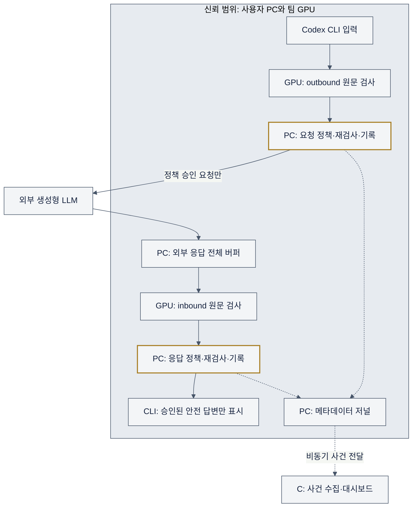
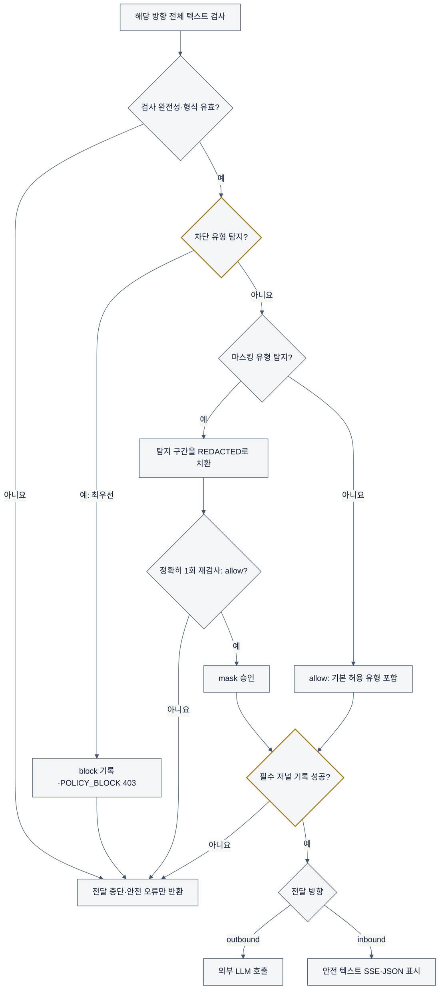
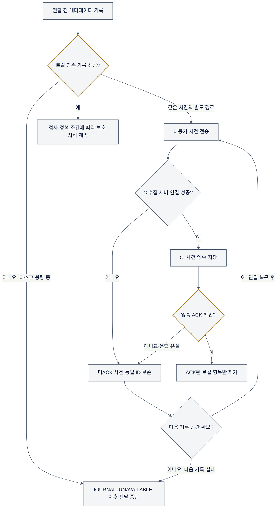

# 프롬프트·응답 보안 처리 시나리오

확인 기준: 2026-10-31 저장소의 B 구현. 이 문서는 현재 지원하는 **고정 Codex CLI 0.166.0 텍스트 전용 보호 프로필**에서 무엇을 전송하고 무엇을 보여주는지 설명한다. 모든 예시는 합성값이며 실제 개인정보·비밀번호·서버 접속 정보가 아니다.

## 1. 사용자가 알아야 할 동작

입력은 사용자 PC의 게이트웨이를 거쳐 팀 GPU 검사 API로 전송된다. **사용자 PC와 GPU 검사 서버가 신뢰 범위이며 GPU에는 원문이 전달된다.** 외부 생성형 LLM에는 검사와 정책 판단을 통과한 요청만 전달한다. 일반 서버의 사건 수집·대시보드는 원문 검사 경로에 들어가지 않는다. ([PRD §1·§3](AI_PII_Gateway_PRD_v1.md))

GPU 검사 API는 유형·위치·점수 등의 `findings`를 반환한다. 최종 `allow/mask/block/error` 결정, 치환, 재검사와 전달 중지는 PC 게이트웨이가 수행한다. 검사 API의 `complete`는 전체 검사 처리가 끝났다는 뜻이며 안전 판정이나 탐지 정확도 보증이 아니다. ([검사 API](../dev/detector/app.py), [정책](../dev/gateway/policy.py), [통제 엔진](../dev/gateway/engine.py))

아래 실선은 정상 승인 경로, 점선은 원문 없는 사건 메타데이터 경로다. 신뢰 범위 안의 GPU 호출에는 원문이 포함되며 저널·C에는 원문을 남기지 않는다. 각 방향의 오류·차단과 필수 저널 기록은 다음 정책 흐름에서 상세히 설명한다.



현재 CLI에는 별도 개인정보 경고 배너·알림창·치환 상세 보고서가 구현되어 있지 않다. 요청 마스킹은 외부 전송 전에 수행하지만 CLI에 정제본을 미리 보여주는 절차는 없다. 승인 버튼이나 원문 복원 버튼도 없다. 응답 마스킹은 최종 답변의 `[REDACTED]`로 보이고, 차단은 안전한 오류 코드로 보인다. 사용자가 직접 입력한 터미널·셸 기록까지 지우는 기능은 아니다. ([HTTP 응답](../dev/gateway/app.py), [실제 CLI 모의 스모크](../dev/integration/run_smoke.py))

차단 오류의 게이트웨이 응답 예시는 다음과 같다. CLI가 붙이는 오류 포맷·재시도 안내는 CLI 동작에 따라 달라질 수 있다. 탐지 원문값은 오류에 넣지 않는다.

```json
{"error":{"type":"gateway_error","code":"POLICY_BLOCK","message":"Protected gateway rejected the request: POLICY_BLOCK."}}
```

## 2. 어떤 정보를 어떻게 처리하는가

아래는 **탐지된 경우**의 기본 정책이다. 탐지 누락이 전혀 없다는 의미가 아니다. 유효한 검사 결과에서는 차단 > 마스킹 > 허용 순서이며, 결과 형식이 잘못되면 먼저 오류로 중단한다. ([policy.py](../dev/gateway/policy.py))

| 처리                       | 유형                                                                                                            | 결과                                        |
| -------------------------- | --------------------------------------------------------------------------------------------------------------- | ------------------------------------------- |
| 차단                       | `KR_RRN`, `CREDIT_CARD`                                                                                     | 요청 전체 또는 응답 전체를 전달하지 않음    |
| 차단                       | 규칙이 인식한 `API_KEY`, `PRIVATE_KEY`                                                                      | 요청 전체 또는 응답 전체를 전달하지 않음    |
| 마스킹                     | `PERSON`, `EMAIL_ADDRESS`, `KR_PHONE_NUMBER`, `KR_BANK_ACCOUNT`, `KR_LOCATION`, `DATE_OF_BIRTH`     | 탐지 구간을 `[REDACTED]`로 치환           |
| 마스킹                     | `KR_DRIVER_LICENSE`, `KR_PASSPORT`, `KR_NHIS`, `KR_VEHICLE_PLATE`, `USERNAME`, `PERSONAL_ATTRIBUTE` | 탐지 구간을 `[REDACTED]`로 치환           |
| 기본 허용·경고 메타데이터 | `ORGANIZATION`, `URL`, `IP_ADDRESS`, `NRP`                                                              | 원문을 유지하며 `policy.warn.*` 규칙 기록 |

이는 모델 대상 PII 18개 유형과 보조 비밀키 규칙 2개 유형이다. **18개를 모두 마스킹하는 정책은 아니다.** 마스킹 범위가 겹치거나 인접하면 병합하고 뒤에서부터 치환한 뒤 최종 텍스트를 정확히 한 번 재검사한다. 재검사가 `allow`가 아니면 전달하지 않는다.

다음 정책 흐름은 outbound와 inbound에 각각 적용한다. outbound에서 중단하면 외부 호출은 0회다. inbound는 외부 호출이 이미 끝난 뒤이며 중단 시 답변을 표시하지 않는다. 차단·오류 사건 기록도 저널 실패 시 `JOURNAL_UNAVAILABLE`로 끝날 수 있다.



그림의 `REDACTED` 표기는 실제로 대괄호를 포함한 `[REDACTED]`다. 마스킹이 금지된 구조 필드는 승인 후 치환 단계에서도 거절하며 전달하지 않는다.

비밀키 규칙은 프로젝트형 OpenAI 키 패턴, 명시적 `AWS_ACCESS_KEY_ID` 대입 문맥의 키 ID, 구조 검사를 통과한 비암호화 DER 개인키 PEM을 지원한다. 실제 키의 유효성 인증은 하지 않는다. 단순히 `API_KEY`라는 단어를 쓰거나 임의 문자열을 비밀번호라고 부르는 것만으로 탐지를 보장하지 않는다. ([secret_rules.py](../dev/gateway/secret_rules.py), [규칙 테스트](../dev/gateway/tests/test_secret_rules.py))

**내부 IP·호스트명·서버 URL·일반 비밀번호·기업 기밀은 자동 차단 대상으로 보장되지 않는다.** 예를 들어 합성 문장 `https://service.example.invalid 상태를 설명해 줘`의 URL만 탐지되면 기본 정책은 허용한다. IP도 내부 주소라는 이유만으로 차단하지 않는다. 조직의 서버 정보를 모두 막으려면 별도의 더 엄격한 정책·탐지 범위와 검증이 필요하며 현재 구현 완료 기능으로 표시하지 않는다.

## 3. 요청: 외부 LLM이 받는 내용

아래 호출 수는 한 번의 게이트웨이 요청 처리 기준이다. 예시는 해당 유형이 탐지되었다고 가정한다.

| 시나리오·합성 입력                           | 외부 LLM 수신                                        | 사용자에게 보이는 결과                              |
| --------------------------------------------- | ---------------------------------------------------- | --------------------------------------------------- |
| 정상: `테스트 계획을 설명해 줘`             | 정책 승인된 원문, 호출 1회                           | 응답도 검사 후 일반 답변                            |
| 이메일: `user@example.invalid 로 회신해 줘` | `[REDACTED] 로 회신해 줘`, 재검사 통과 후 호출 1회 | 별도 요청 치환 미리보기 없이 답변 대기              |
| 고위험: `주민번호 900101-1234567`           | 호출 **0회**                                   | HTTP 403 / `POLICY_BLOCK`; 탐지값 없는 오류       |
| 카드 또는 지원 패턴 비밀키 탐지               | 호출 **0회**                                   | HTTP 403 / `POLICY_BLOCK`                         |
| 이메일과 고위험 정보가 함께 탐지됨            | 호출 **0회**                                   | 일부만 마스킹해 보내지 않고 전체 차단               |
| URL·IP·조직·NRP만 탐지됨                   | 기본 정책에서는 해당 원문, 호출 1회                  | 일반 답변; 경고 메타데이터가 CLI 배너를 뜻하지 않음 |

검사 대상은 사용자 프롬프트만이 아니다. 지원 메시지의 system/developer/user/assistant 텍스트와 허용된 CLI 도구 정의의 설명·문법·스키마 문자열·키·숫자 표현도 포함한다. 합산 16,000 코드포인트를 넘으면 조용히 자르지 않고 거절한다. CLI telemetry는 검증 후 외부 전송에서 제거하고 `store=false`, `parallel_tool_calls=false`, `tool_choice=none`을 강제한다. 구조 식별자·문법·기본값 등 바꿀 수 없는 부분에 마스킹이 필요하면 `UNSAFE_REPLACEMENT`로 중단한다. ([CLI 어댑터](../dev/gateway/cli_request.py), [프로토콜](../dev/gateway/responses.py))

## 4. 응답: 사용자가 받는 내용

외부 응답은 **전체를 버퍼링한 뒤** 지원 텍스트 구조인지 확인하고 inbound 검사·필요한 마스킹 재검사·영속 기록을 끝낸다. 그 전에는 답변 content delta를 CLI로 내보내지 않는다. 이후 안전 텍스트로 SSE 이벤트를 새로 만든다. 따라서 외부 LLM의 실시간 토큰이 그대로 먼저 표시되지 않으며 첫 표시까지 기다리는 시간이 생긴다. ([전송기](../dev/gateway/transport.py), [app.py](../dev/gateway/app.py), [responses.py](../dev/gateway/responses.py))

| 외부 LLM 응답·상황                              | 사용자가 받는 내용                                     | 외부 호출 여부 |
| ------------------------------------------------ | ------------------------------------------------------ | -------------- |
| 정상 텍스트                                      | 검사된 일반 답변                                       | 이미 호출됨    |
| `회신: answer@example.invalid`에서 이메일 탐지 | `회신: [REDACTED]`, 재검사 통과 후 표시              | 이미 호출됨    |
| 주민번호·카드·지원 비밀키 탐지                 | 답변 원문 없이 HTTP 403 / `POLICY_BLOCK`             | 이미 호출됨    |
| 마스킹 후 민감정보 잔존·재검사 실패             | 답변 없이 HTTP 503 / `REINSPECTION_FAILED`           | 이미 호출됨    |
| 미완료 응답·알 수 없는 출력·도구 호출 출력     | 답변·도구 실행 없이 HTTP 503 / `UNSUPPORTED_OUTPUT` | 이미 호출됨    |

inbound 차단은 사용자에게 위험한 응답이 보이는 것을 막는다. 외부 LLM에 이미 전달된 요청이나 이미 수행된 외부 처리를 되돌리지는 않는다. 취소 시 늦게 도착한 결과를 폐기하며 외부 취소의 성공까지 보장하지 않는다.

## 5. 프롬프트와 사용자 화면 예시

아래는 **합성 입력에 대한 설명용 화면 예시**다. 자연어 답변은 실제 OpenAI 실행 기록이나 M0 품질 검증 결과가 아니라 예상 동작을 설명하는 예시다. 개인정보가 등장하는 사례는 해당 유형이 탐지되었다고 가정한다. 오류 블록은 게이트웨이가 반환하는 실제 `message` 문자열이다. 고정 CLI가 앞뒤에 붙이는 HTTP 상태·URL·재시도 문구·출력 포맷은 달라질 수 있다. 오류만 보고 탐지 유형이나 원문 위치를 자동으로 확인할 수는 없다.

### 5-1. 정상 업무 질문

입력:

```text
개인정보를 넣지 않고 고객 문의 답변의 기본 구성을 3줄로 설명해 줘.
```

사용자가 보는 안전한 답변 예시:

```text
문의 내용을 간단히 확인합니다.
해결 방법과 필요한 절차를 안내합니다.
추가 문의 방법을 덧붙입니다.
```

외부 LLM: 승인된 원문 수신, 호출 1회. 다음 행동: 답변을 확인한다.

### 5-2. 고객 이메일을 넣은 요청

입력:

```text
고객 user@example.invalid 에 보낼 배송 지연 사과 메일을 작성해 줘.
```

사용자가 보는 답변 예시:

```text
안녕하세요. 배송이 지연되어 불편을 드린 점 사과드립니다.
확인되는 대로 변경된 배송 일정을 안내드리겠습니다.
```

외부 LLM: `고객 [REDACTED] 에 보낼 배송 지연 사과 메일을 작성해 줘.` 수신, 재검사 통과 후 호출 1회. 이 정제 문자열은 **문서의 설명이며 실제 CLI 미리보기 화면이 아니다.** 사용자는 일반 답변만 볼 수 있다. 다음 행동: 수신 주소 등 실제 발송 정보를 필요한 업무 시스템에서 직접 확인한다. 이 기능이 메일을 발송하지는 않는다.

### 5-3. 주민번호가 포함되어 요청 전체 차단

입력:

```text
고객 주민번호 900101-1234567 을 포함해 본인 확인 안내문을 만들어 줘.
```

사용자가 오류에서 확인할 게이트웨이 메시지(HTTP 403):

```text
Protected gateway rejected the request: POLICY_BLOCK.
```

외부 LLM: 호출 **0회**. 화면에 주민번호나 `KR_RRN` 유형 설명을 자동으로 다시 보여주지 않는다. 카드번호나 지원 패턴 API 키·개인키가 탐지되어도 같은 일반 오류 코드다.

다음 행동: 고위험 값을 직접 지우거나 의미를 설명하는 비민감 표현으로 바꾼 뒤 지원하는 CLI 실행으로 **새로 요청**한다. ‘그래도 보내기’ 승인, 차단 대기열, 수정 후 자동 제출 기능은 없다.

수정한 입력:

```text
주민번호 원문 없이 고객이 공식 본인 확인 절차를 이용하도록 안내문을 만들어 줘.
```

재검사 통과 후 사용자 답변 예시:

```text
본인 확인은 공식 인증 화면에서 진행해 주세요.
주민번호 등 민감정보를 채팅이나 이메일에 적지 마세요.
```

수정 요청은 별도 처리이며 승인되면 외부 호출 1회다. 차단된 원래 요청이 재전송되는 것은 아니다.

### 5-4. 외부 응답의 이메일만 가려서 표시

입력:

```text
가상의 고객 안내문 예시를 작성해 줘.
```

외부 응답에 합성 이메일이 있고 `EMAIL_ADDRESS`로 탐지된 경우 사용자 화면:

```text
담당자에게 문의하려면 [REDACTED] 로 연락해 주세요.
```

외부 LLM: 승인된 질문으로 이미 1회 호출됨. 원래 답변의 이메일은 버퍼·검사 중에 먼저 표시하지 않는다. 다음 행동: 가려진 주소를 복원하려 하지 말고, 실제 연락처는 승인된 업무 자료에서 확인한다.

### 5-5. 외부 응답에서 고위험 정보 탐지

입력:

```text
고객 상담 기록을 안전하게 작성하는 방법을 설명해 줘.
```

외부 응답에 주민번호·카드·지원 비밀키가 탐지된 경우 사용자 오류(HTTP 403):

```text
Protected gateway rejected the request: POLICY_BLOCK.
```

외부 LLM: 질문으로 이미 1회 호출됨. 위험한 답변 원문과 일부 토큰은 표시하지 않는다. 코드만으로 요청과 응답 중 어느 쪽이 차단됐는지 식별하기 어려울 수 있다. 다음 행동: 운영자가 원문 없는 사건의 `direction`을 확인하고, 사용자는 민감정보 없는 일반 설명을 요청하도록 질문을 수정한다. 재요청도 다시 검사한다.

### 5-6. GPU 검사 API 연결 실패

입력:

```text
오늘 작성할 테스트 계획의 목차를 제안해 줘.
```

outbound 검사 연결이 실패한 경우 사용자 오류(HTTP 503):

```text
Protected gateway rejected the request: INSPECTION_FAILED.
```

외부 LLM: 호출 **0회**. 평범한 질문이라도 검사를 생략하지 않는다. 다음 행동: 운영자가 검사 API 연결·상태를 복구한 후 새로 요청한다. 사용자가 보호 경로를 우회하거나 오류를 승인해서 전송하는 기능은 없다. 같은 오류가 inbound에서 발생했다면 외부 호출은 이미 수행됐지만 답변은 표시되지 않는다.

### 5-7. 서버 URL·IP·일반 비밀번호 보호의 한계

입력:

```text
합성 주소 https://service.example.invalid 와 192.0.2.10 의 차이를 설명해 줘.
비밀번호란 어떤 용도로 쓰는 값인지 일반적으로 설명해 줘.
```

URL·IP 외에 차단·마스킹 유형이 탐지되지 않은 경우 사용자 답변 예시:

```text
URL은 서비스 자원의 위치를 표현하고 IP 주소는 네트워크 주소를 표현합니다.
비밀번호는 사용자를 인증하는 데 쓰는 비밀값입니다.
```

외부 LLM: 기본 정책에서는 합성 URL·문서용 IP를 포함한 승인 원문 수신, 호출 1회. 이 예시는 실제 비밀번호를 넣지 않는다. **실제 내부 주소·호스트명이나 일반 비밀번호도 모두 자동 차단된다고 기대하면 안 된다.** 다음 행동: 운영 접속 정보는 프롬프트에서 직접 제외하고, 조직에서 서버 정보 전체 차단이 필요하면 별도 정책·탐지 검증을 요청한다. 답변이 나왔다는 사실만으로 보안상 안전한 입력이었다고 판단하지 않는다.

## 6. 장애·미지원 경로

아래는 CLI에 반환하는 **게이트웨이 오류**다. GPU 검사 API 자체의 HTTP 상태·소문자 `error_code`와 구분한다. 어떤 단계에서 실패했는지에 따라 외부 호출 여부가 달라진다. ([engine.py](../dev/gateway/engine.py), [transport.py](../dev/gateway/transport.py))

| 상황                                                                        | 게이트웨이 응답                                                                | 전달 결과                                                     |
| --------------------------------------------------------------------------- | ------------------------------------------------------------------------------ | ------------------------------------------------------------- |
| GPU 연결 실패·검사 timeout·API 오류                                       | HTTP 503 / `INSPECTION_FAILED`                                               | outbound면 외부 호출 0회, inbound면 답변 미표시               |
| `incomplete`·잘못된 span·미등록 finding 유형                            | HTTP 503 / `INSPECTION_INVALID` 또는 전송 검증 단계의 `INSPECTION_FAILED`  | 안전으로 간주하지 않고 중단                                   |
| 요청·검사 ID 불일치                                                        | HTTP 503 / `INSPECTION_IDENTITY` 또는 전송 검증 단계의 `INSPECTION_FAILED` | 중단                                                          |
| 요청과 응답 검사 사이 모델·임계값 버전 변경                                | HTTP 503 / `MODEL_CHANGED`                                                   | 응답 미표시; 오류 사건 버전은 `unknown`                     |
| 마스킹 재검사에서 버전 변경·오류·잔존 탐지                                | HTTP 503 / `REINSPECTION_FAILED`                                             | 해당 방향 전달 중단                                           |
| 도구 결과·이미지·첨부·암호화 이력·`previous_response_id` 등 상태 참조 | HTTP 400 / `UNSUPPORTED_PROTOCOL`                                            | outbound에서 거절, 외부 호출 0회                              |
| 미허용 모델 ID·알 수 없는 요청 필드·텍스트 한도 초과                      | HTTP 400 / `UNSUPPORTED_PROTOCOL`                                            | 외부 호출 0회                                                 |
| 외부 공급자 실패·timeout                                                   | HTTP 503 / `UPSTREAM_FAILED`                                                 | 전송 여부가 불명일 수 있음; 게이트웨이가 자동 재호출하지 않음 |
| 로컬 저널 가득 참·디스크 쓰기 실패                                         | HTTP 503 / `JOURNAL_UNAVAILABLE`                                             | 실패한 단계 이후 전달 중단                                    |

지원하는 소수 `functions.exec/wait` **정의**를 검사하는 것과 도구 실행 지원은 다르다. 자동 실행은 끄고 도구 호출·결과 출력은 차단한다. ChatGPT 웹·공식 앱, 임의 Codex 버전·설정, 다른 네트워크 경로 전체가 보호된다고 주장하지 않는다. ([CLI 호환 기록](../dev/integration/CLI_COMPATIBILITY_NOTES.md))

## 7. 사건 기록과 대시보드 장애

사건에는 원문 프롬프트·답변·탐지값을 저장하지 않는다. 현재 B 저널의 18개 필드는 식별자, 시각, 방향, 단계, 결정, 전달 상태, 유형별 건수, 규칙·버전·경과시간·안전 오류 코드다. 필드 전체와 화면 해석은 [대시보드 개발 가이드 §2](DASHBOARD_DEVELOPMENT_GUIDE.md#2-현재-b-사건-메타데이터), 입력 샘플은 [합성 데이터](dashboard_example_dataset.log)를 따른다. 샘플은 실제 사용자 로그가 아니다.

- `direction=outbound/inbound`는 요청과 응답을 구별한다. 같은 `request_id`의 한쪽 허용이 다른 쪽 허용을 뜻하지 않는다.
- `stage=decision`과 `stage=delivery`는 별도 사건이다. `decision=mask`만으로 정제본 전달 성공을 확정하지 않는다.
- `delivery_status=not_sent`는 그 판단 시점, `unknown`은 전달 여부 미확정이다. outbound는 호출 전 `unknown`을 영속 기록하고 응답 수신 후 `forwarded_original/forwarded_sanitized`를 기록한다.
- inbound `delivered`는 ASGI 서버가 안전 바이트 전부를 수락했다는 뜻이다. CLI 화면 표시 확인이나 중앙 서버 ACK를 뜻하지 않는다.
- 검사 버전을 확정하지 못한 오류는 `model_version=unknown`과 안전 오류 코드로 기록한다. GPU 내부 예외·원문을 오류 설명에 복사하지 않는다.

중앙 사건 서버·대시보드가 내려가도 로컬 저널이 정상이고 다른 검사 조건이 충족되면 보호 처리는 계속된다. 연결된 C 계약 어댑터가 복구되면 **사건만** 같은 ID로 재전송하고 영속 ACK된 항목만 제거한다. 외부 LLM 요청을 재실행하지 않는다. C 실제 구현·화면 복구 완료는 별도 검증 대상이다. ([journal.py](../dev/gateway/journal.py), [재전송](../dev/gateway/delivery.py), [REPLAY.md](../dev/gateway/REPLAY.md))

저널 기록 자체가 실패하면 fail-closed다. outbound 전 기록 실패면 외부 호출 0회, 외부 호출 후 inbound 기록 실패면 답변을 내보내지 않는다. 안전 바이트 전달 **후** 마지막 기록이 실패한 경우 이미 표시된 내용을 되돌릴 수 없으므로 `unknown`을 유지하고 이후 요청을 거절하며 readiness를 비정상으로 바꾼다. 저널 장애 사건이 반드시 중앙에 남는다고 보장하지 않는다. ([장애 경계 테스트](../dev/gateway/tests/test_adversarial.py))



중앙 장애 자체는 GPU 검사·정책 경로를 막지 않는다. 미전송 적재로 로컬 용량이 소진되어 새 기록이 실패하면 그때 전달을 중단한다. 위 재전송은 사건만 대상으로 하며 외부 LLM 호출은 반복하지 않는다. C 영속 저장·ACK 연결은 합의된 실제 어댑터가 필요하다.

## 8. 합성 환경 수동 인수 체크리스트

실제 개인정보·운영 비밀값 대신 위 합성값과 기존 fixture를 사용한다. 다음은 확인 항목과 기존 검증 근거이며 이 문서 작성 중 서버 호출·테스트를 새로 실행한 결과는 아니다.

| 확인                      | 통과 조건·기존 근거                                                                                                                                                                                                            |
| ------------------------- | ------------------------------------------------------------------------------------------------------------------------------------------------------------------------------------------------------------------------------- |
| ☐ 정상 왕복              | 일반 답변 표시; [run_smoke.py](../dev/integration/run_smoke.py)의 `normal`, `real_cli_normal`                                                                                                                                |
| ☐ 요청 이메일 마스킹     | 공급자 수신에 원문 없음·재검사 수행; [test_engine.py](../dev/gateway/tests/test_engine.py)의 `test_both_directions_mask_and_reinspect_without_original_in_wire_or_journal`                                                    |
| ☐ 고위험 요청 차단       | 공급자 호출 0·오류에 원문 없음; 같은 파일의 `test_request_block_makes_zero_upstream_calls`                                                                                                                                   |
| ☐ 응답 마스킹·차단      | 최종 `[REDACTED]` 또는 `POLICY_BLOCK`; 스모크의 `real_cli_inbound_mask/block`                                                                                                                                             |
| ☐ 조기 표시 없음         | 공급자 전체 응답·검사 전 바이트 0; [test_app.py](../dev/gateway/tests/test_app.py)의 `test_no_cli_response_start_until_full_upstream_and_inspection`                                                                          |
| ☐ 검사 실패·재검사 잔존 | 전달 중단; [test_engine.py](../dev/gateway/tests/test_engine.py)의 `test_failures_before_dispatch_never_call_upstream`                                                                                                         |
| ☐ malformed·버전 변경   | 원문 미표시·안전 오류; [test_adversarial.py](../dev/gateway/tests/test_adversarial.py)의 `test_malformed_detector_response_is_never_converted_to_clean`, `test_inbound_cannot_switch_model_or_threshold_within_one_request` |
| ☐ 미지원 도구·이력      | 요청 거절 또는 출력 폐기; [test_cli_request.py](../dev/gateway/tests/test_cli_request.py)의 `test_tool_results_encrypted_history_and_unsupported_contents_are_never_forwarded` 및 스모크 `real_cli_tool_output_block`        |
| ☐ 중앙 장애·재시작 복구 | 미ACK 보존·동일 ID 재전송; [test_delivery.py](../dev/gateway/tests/test_delivery.py)의 `test_restart_after_lost_receipt_replays_identical_committed_ids_and_deduplicates`                                                     |
| ☐ 저널 쓰기 실패         | 전달 중단·복구 후 pending 보존; [test_journal_storage_fault.py](../dev/gateway/tests/test_journal_storage_fault.py)의 `test_os_write_failure_blocks_forwarding_and_preserves_retry_after_restart`                             |

기존 [CLI 호환 기록의 통합 검증](../dev/integration/CLI_COMPATIBILITY_NOTES.md#통합-이후-검증)은 모의 검사기·공급자에 대한 HTTP 6개와 실제 고정 CLI 7개, 총 13개 통과를 기록한다. 현재 M0 GPU 검사 API의 PC HTTPS 호출·TLS 호스트명 검증·잘못된 토큰 401·Unicode 전체 검사 및 버전 확인은 통과했으며, 모델 활성화·재시작의 세부 범위는 [GPU 시험 배포 결과](../dev/deployment/GPU_TRIAL_RESULTS.md)를 따른다. 실제 GPU와 외부 OpenAI를 잇는 전체 CLI 왕복, 한국어 모델 품질, 실제 C 화면 검증은 별도 미완료 항목이다. API 배포 성공만으로 모든 개인정보·서버 비밀정보의 유출 방지를 보장하지 않는다.
