# 한국어 개인정보 탐지 모델 개선 보고서 v1

작성: 2026-11-01 · **7.5단계 오프라인 최종 평가(동결 서비스 시험 300건 + 공식 Test 28,142건) 완료 · B 운영 인수 별도 대기 (`pending_runtime_acceptance`)**

7.5단계에서 학습·추론 분할기 정렬(`ko_atomic_suffix_v3`), 미완료 검사(`incomplete`) fail-closed 검증, Dev 기반 저장본·임계값 사전 고정(`checkpoint-1262`, 공통 임계값 `0.5`), 사람 검토 후 동결한 서비스 holdout 300건 및 공식 `test_track_a` 28,142건 최종 평가를 모두 완료했습니다.

- **동결 서비스 시험(300건)**: 전체 micro F1 **76.50% → 89.38% (`+12.88%p`, 95% CI `+9.14~+16.63%p`)**, 중요 5종 micro 재현율 **89.52% → 94.76% (`+5.24%p`, 95% CI `+2.47~+8.45%p`)**, 정상 문서 차단·오류 **1/100 → 2/100 (`+1.00%p`, 허용 상한 `+1.00%p` 경계 통과)**.
- **공식 Test(`test_track_a`, 28,142건)**: 전체 micro F1 **66.58% → 98.70% (`+32.12%p`, 95% CI `+31.92~+32.30%p`)**, 중요 5종 micro 재현율 **78.67% → 99.99% (`+21.32%p`, 95% CI `+20.95~+21.64%p`, 미탐 `8,940개 → 3개`)**.
- **최종 판정**: A 영역의 오프라인 수치 게이트는 충족했으나, 정상 문서 오차단 여유가 좁고(`2/100`, 상한 경계) 마스킹 후 1회 재검사 실패(`error`) 비율 및 **B 런타임·통합·지연·메모리·분할기 채택 인수(`runtime_acceptance=None`, `b_splitter_adoption=False`)가 남아 있으므로 현재 판정은 `pending_runtime_acceptance`(교체 보류·B 인수 대기)**입니다. B 운영 인수 전까지 운영 기본 모델은 M0를 유지합니다.

---

## 1. 무엇을 개선하려 했나요?

문장에서 이름·전화번호·주민등록번호·계좌번호·신용카드번호 같은 개인정보의 종류와 정확한 문자 위치(`start`, `end`)를 찾는 모델을 한국어 자료로 미세조정했습니다.
- **M0**: 고정한 원본 GLiNER (`urchade/gliner_multi_pii-v1`, revision `fab5ed968bcd2eb8bca0d8bc3ad3fc93ede2fd2c`)
- **M1**: 기존 실행에서 K-PII-Bench 학습셋 5,000문서(`train_5k.jsonl`)로 2 epoch 미세조정한 저장본(`checkpoint-1262`)

7.5단계에서는 무작정 재학습을 반복하기보다 7단계 검토([stage7-review-v1.md](reports/stage7-review-v1.md))에서 발견된 **실행·채점·비교 프로토콜 결함**을 먼저 바로잡았습니다.
1. **학습·추론 분할기 일치**: 학습 데이터 변환에만 쓰였던 한국어 조사 분리 규칙(`ko_atomic_suffix_v3`)을 실제 GLiNER 런타임(`data_processor.words_splitter`)과 창 계획에 동일하게 주입하고 새 프로세스 재로딩 후 토큰·스팬 위치 일치를 검증했습니다.
2. **미완료(`incomplete`) 검사 차단**: 긴 문장에서 창 검사가 끝까지 수행되지 못한 경우를 빈 정상 탐지로 채점하지 않도록 차단하고, 모든 평가 문서가 `complete` 상태임을 검증했습니다.
3. **B 실제 게이트웨이 정책 및 1회 재검사 결합**: 단순 1차 스팬 비교에 그치지 않고, B의 실제 정책 엔진(`dev/gateway/policy.py`, `dev/gateway/engine.py`)을 통해 마스킹 후 1회 재검사(`B-gateway-one-reinspection-v1`)까지 오프라인으로 실측했습니다. 정상 문서 실패율은 **명시적 차단(`block`)과 재검사 실패 등으로 인한 오류(`error`)를 모두 합산한 전송 거부 비율**로 엄격히 정의했습니다.

---

## 2. 실험 조건과 고정 증거

| 항목 | 확인 내용 및 근거 파일 |
|---|---|
| 모델·데이터 원본 | [고정 revision](configs/assets.lock.json), [서버 회수 해시·환경](reports/stage7_5-recovery-v2.json), [인수인계 무결성](reports/stage7_5-handoff-integrity-v1.json) |
| GPU 환경 | NVIDIA L4 (24GB), Python 3.12.16, PyTorch 2.10.0, GLiNER 0.2.29, Transformers 4.57.3, Tokenizers 0.22.2 |
| 기존 학습 표본 | `train_5k.jsonl`: 5,000문서, 고유 문장 4,996개(중복 4건), 변환 5,048창. 변환 성공 앞 문서를 순차 채택한 기존 표본 |
| 새 균형 표본 | [stage7_5-sample-v1.json](reports/stage7_5-sample-v1.json): 고유 5,000문서·5,058창, 12개 분야 균형. **준비만 완료했으며 현재 M1 학습에는 미사용** |
| 학습 인자 증거 | 복구된 실행 소스 기준 batch 8·누적 1·LR 3e-5·warmup ratio 0.1·2 epoch. 별도 `training_args.bin` 미보존으로 CLI 재정의 여부는 단정하지 않음 |
| 학습 로그 | [`trainer_state.json`](reports/stage7_5-recovery-v2.json): step 50 loss `71.1466` → step 631(epoch 1) → step 1250 loss `1.2245` (과거 보고의 시작 `8.61`은 원본 첫 기록이 아님) |
| Dev 설정 선택 | [stage7_5-selection-v1.json](reports/stage7_5-selection-v1.json): K-PII-Bench dev 28,147건 + 정상 조정셋 200건(총 28,347건). `M0`, `M1 epoch 1(checkpoint-631)`, `M1 epoch 2(checkpoint-1262)`에 동일 임계값 `{0.35, 0.5, 0.65, 0.8}` 탐색 |
| 선택 결과 | **M1 `checkpoint-1262` + 공통 임계값 `0.5` + 분할기 `ko_atomic_suffix_v3`** 고정. Dev 정상 조정셋에서는 M1이 모든 임계값에서 `10/200(5.0%)` 차단(`M0 0/200`)되어 사전 정의된 fallback 규칙(중요 5종 재현율 우선 → 전체 F1 우선)으로 선택 |
| 동결 서비스 시험 | 사용자 전수 재검토·동결 승인 `service-holdout-v2-r2` 300건(요청 150·응답 150, 양성 200·정상 100, 중요 5종 각 30개 이상). [동결 매니페스트](evaluation/service-holdout-v2-r2.frozen.manifest.json), [결과 JSON](reports/stage7_5-service-final-v1.json) |
| 공식 Test | 고정 `test_track_a.jsonl` 28,142건(정답 스팬 121,176개, 정상 문서 0건). [결과 JSON](reports/stage7_5-official-final-v1.json) |

[평가·선택 계획](configs/stage7_5-evaluation-plan.json)은 시험셋 동결 후 Dev 평가 전에 먼저 기록했으며, 최종 시험(서비스 300건·공식 Test 28,142건) 결과를 보고 모델 가중치나 임계값을 다시 조정하지 않았습니다.

---

## 3. 단계별 성능 요약 (Dev → 동결 서비스 300건 → 공식 Test 28,142건)

### 3.1 Dev 설정 선택 요약 (28,347건: 원본 Dev 28,147건 + 정상 조정 200건)

공통 임계값 `0.5` 및 `ko_atomic_suffix_v3` 조건에서의 Dev 측정 결과입니다([stage7_5-selection-v1.json](reports/stage7_5-selection-v1.json)).

| 모델 (`threshold=0.5`) | 전체 Micro Precision | 전체 Micro Recall | 전체 Micro F1 | 중요 5종 Micro Recall | 정상 조정셋 실패 (`200건`) |
|---|---:|---:|---:|---:|---:|
| **M0 (`dev-m0-v1`)** | `60.01%` | `66.31%` | `63.00%` (`63.0047%`) | `74.71%` (`34,373/46,009`) | `0/200` (`0.00%`) |
| **M1 Epoch 1 (`checkpoint-631`)** | `94.59%` | `98.13%` | `96.32%` (`96.3236%`) | `100.00%` (`46,007/46,009`, `99.9957%`) | `10/200` (`5.00%`) |
| **M1 Epoch 2 (`checkpoint-1262`, 선택)** | **`97.07%`** | **`98.49%`** | **`97.77%` (`97.7746%`)** | **`100.00%` (`46,007/46,009`, `99.9957%`)** | `10/200` (`5.00%`) |

- **관측 사실**: 공통 한국어 조사 분리(`ko_atomic_suffix_v3`)만 적용해도 M0의 Dev F1은 `63.00%`로 측정됩니다(과거 기본 분할기 조건의 `19.61%`와 조건이 다르므로 단순 차감하여 미세조정 효과로 부풀리지 않습니다). 동일 분할 조건에서 M1(`checkpoint-1262`)은 Dev 전체 F1을 `63.00% → 97.77%`(`+34.77%p`), 중요 5종 재현율을 `74.71% → 100.00%`(`+25.29%p`)로 높였습니다.
- **임계값 조정 가설 기각**: M1은 임계값을 `0.35 → 0.5 → 0.65 → 0.8`로 올려도 정상 조정 문서 200건 중 계산용 13자리 정수 예제 등 숫자 유사(`numeric_lookalikes`) 10건에서 `KR_RRN` 점수가 `0.8`을 넘어 동일하게 `10/200(5.00%)` 오차단이 발생했습니다. 즉 “패키징 단계에서 임계값만 `0.65~0.7`로 올리면 오차단이 즉시 해결된다”는 기존 가정은 실측으로 기각되었습니다.

---

### 3.2 동결 서비스 최종 시험 결과 (`service-holdout-v2-r2`, 300건)

양쪽 모델 모두 **300/300건 `complete` (`incomplete=0`, `error=0`)**로 추론을 마쳤으며, 동일 조건(`condition-sha256:da4fa832...`)에서 채점했습니다([stage7_5-service-final-v1.json](reports/stage7_5-service-final-v1.json)).

| 지표 (`service-holdout-v2-r2`, 300건) | M0 (`final-service-m0-v1`) | M1 (`final-service-m1-v1`) | 변화 (`M1 - M0`) | 문서 짝지은 95% 신뢰구간 |
|---|---:|---:|---:|---:|
| **전체 Micro Precision** | `70.12%` (`tp=535, fp=228`) | **`85.68%`** (`tp=595, fp=99`) | **`+15.56%p`** | — |
| **전체 Micro Recall** | `84.15%` (`fn=101, gold=636`) | **`93.41%`** (`fn=42, gold=636`) | **`+9.27%p`** | — |
| **전체 Micro F1** | `76.50%` | **`89.38%`** | **`+12.88%p`** | **`+9.14%p ~ +16.63%p`** |
| **중요 5종 Micro Precision** | `94.00%` (`tp=188, fp=12`) | **`93.43%`** (`tp=199, fp=14`) | `-0.57%p` | — |
| **중요 5종 Micro Recall** | `89.52%` (`188/210`) | **`94.76%`** (`199/210`) | **`+5.24%p`** | **`+2.47%p ~ +8.45%p`** |
| **중요 5종 Micro F1** | `91.71%` | **`94.09%`** | **`+2.38%p`** | — |
| **중요 5종 미탐 합계** | `22 / 210` | **`11 / 210`** | **`-11개`** | — |
| `KR_RRN` 재현율 (gold `40`) | `72.50%` (미탐 `11`) | **`100.00%`** (미탐 **`0`**) | **`+27.50%p`** | `+13.89%p ~ +41.94%p` |
| `KR_BANK_ACCOUNT` 재현율 (gold `42`) | `95.24%` (미탐 `2`) | **`95.24%`** (미탐 `2`) | `0.00%p` | `0.00%p ~ 0.00%p` |
| `CREDIT_CARD` 재현율 (gold `38`) | `94.74%` (미탐 `2`) | **`94.74%`** (미탐 `2`) | `0.00%p` | `0.00%p ~ 0.00%p` |
| `KR_PHONE_NUMBER` 재현율 (gold `45`) | `95.56%` (미탐 `2`) | **`95.56%`** (미탐 `2`) | `0.00%p` | `0.00%p ~ 0.00%p` |
| `EMAIL_ADDRESS` 재현율 (gold `45`) | `88.89%` (미탐 `5`) | **`88.89%`** (미탐 `5`) | `0.00%p` | `0.00%p ~ 0.00%p` |
| **정상 문서 차단·오류 (`100건`)** | `1/100` (`1.00%`, Wilson `0.18~5.45%`) | **`2/100`** (`2.00%`, Wilson `0.55~7.00%`) | **`+1.00%p`** | `-2.00%p ~ +5.00%p` |
| 전달 문서(`allow`/`mask`) 내 보호 대상 잔존율 | `40.74%` (`22 / 54`) | **`7.59%`** (`6 / 79`) | **`-33.15%p`** | — |
| 게이트웨이 동작 (`allow / mask / block / error`) | `98 / 34 / 76 / 92` | **`93 / 57 / 93 / 57`** | `error -35건` | — |
| 오프라인 추론+정책+재검사 지연 (`p50 / p95 / p99`) | `21.25 / 94.96 / 188.21 ms` | **`20.87 / 94.54 / 183.76 ms`** | 전 구간 단축 | — |

- **중요 5종 및 비핵심 유형 변화**: 중요 5종에서는 퇴행한 유형이 없으며, `KR_RRN` 미탐 `11건`이 전부 해소되어(`72.50% → 100.00%`) 중요 5종 전체 미탐이 `22개 → 11개`로 절반 감소했습니다. 반면 비중요 유형 중 `DATE_OF_BIRTH`(`96.67% → 86.67%`, 미탐 `+3`), `KR_LOCATION`(`84.62% → 80.77%`, 미탐 `+1`), `PERSONAL_ATTRIBUTE`(`30.00% → 10.00%`, 미탐 `+2`), `USERNAME`(`88.89% → 77.78%`, 미탐 `+2`)는 재현율이 낮아졌고, `PERSON`(`65.00% → 98.00%`, 미탐 `-33`), `ORGANIZATION`(`74.47% → 100.00%`, 미탐 `-12`), `KR_PASSPORT`(`47.06% → 88.24%`, 미탐 `-7`), `KR_VEHICLE_PLATE`(`23.53% → 94.12%`, 미탐 `-12`), `NRP`(`14.29% → 78.57%`, 미탐 `-9`)는 크게 개선되었습니다.
- **`model_only` vs `model_plus_same_rules`**: 본 서비스 시험셋에는 `API_KEY`/`PRIVATE_KEY` 규칙 패턴이 포함되지 않아 두 보고 모드의 엔터티 및 정책 수치는 동일합니다.

---

### 3.3 공식 Test 최종 시험 결과 (`test_track_a.jsonl`, 28,142건)

양쪽 모델 모두 **28,142/28,142건 `complete` (`incomplete=0`, `error=0`)**로 추론과 게이트웨이 1회 재검사 채점을 완주했으며, 동일 조건(`condition-sha256:5b3c312c...`)에서 비교했습니다([stage7_5-official-final-v1.json](reports/stage7_5-official-final-v1.json)).

| 지표 (`test_track_a`, 28,142건) | M0 (`final-official-m0-v1`) | M1 (`final-official-m1-v1`) | 변화 (`M1 - M0`) | 문서 짝지은 95% 신뢰구간 |
|---|---:|---:|---:|---:|
| **전체 Micro Precision** | `63.59%` (`tp=84,671, fp=48,478`) | **`98.13%`** (`tp=120,297, fp=2,288`) | **`+34.54%p`** | — |
| **전체 Micro Recall** | `69.87%` (`fn=36,505, gold=121,176`) | **`99.27%`** (`fn=879, gold=121,176`) | **`+29.40%p`** | — |
| **전체 Micro F1** | `66.58%` | **`98.70%`** | **`+32.12%p`** | **`+31.92%p ~ +32.30%p`** |
| **중요 5종 Micro Precision** | `95.39%` (`tp=32,982, fp=1,594`) | **`100.00%`** (`tp=41,919, fp=0`) | **`+4.61%p`** | — |
| **중요 5종 Micro Recall** | `78.67%` (`32,982/41,922`) | **`99.99%`** (`41,919/41,922`) | **`+21.32%p`** | **`+20.95%p ~ +21.64%p`** |
| **중요 5종 Micro F1** | `86.23%` | **`100.00%`** (`99.996%`) | **`+13.77%p`** | — |
| **중요 5종 미탐 합계** | `8,940 / 41,922` | **`3 / 41,922`** | **`-8,937개`** | — |
| `KR_RRN` 재현율 (gold `12,048`) | `28.16%` (미탐 `8,655`) | **`99.98%`** (미탐 **`3`**) | **`+71.81%p`** | `+70.98%p ~ +72.61%p` |
| `KR_BANK_ACCOUNT` 재현율 (gold `4,081`) | `99.36%` (미탐 `26`) | **`100.00%`** (미탐 **`0`**) | **`+0.64%p`** | `+0.41%p ~ +0.87%p` |
| `CREDIT_CARD` 재현율 (gold `2,266`) | `100.00%` (미탐 `0`) | **`100.00%`** (미탐 **`0`**) | `0.00%p` | `0.00%p ~ 0.00%p` |
| `KR_PHONE_NUMBER` 재현율 (gold `11,482`) | `99.70%` (미탐 `34`) | **`100.00%`** (미탐 **`0`**) | **`+0.30%p`** | `+0.20%p ~ +0.40%p` |
| `EMAIL_ADDRESS` 재현율 (gold `12,045`) | `98.13%` (미탐 `225`) | **`100.00%`** (미탐 **`0`**) | **`+1.87%p`** | `+1.64%p ~ +2.12%p` |
| **정상 문서 차단·오류** | `N/A` (정상 문서 `0건`) | `N/A` (정상 문서 `0건`) | `N/A` | 동결 서비스 시험셋(`2/100`) 사용 |
| 전달 문서(`allow`/`mask`) 내 보호 대상 잔존율 | `21.89%` (`1,983 / 9,061`) | **`0.95%`** (`60 / 6,325`) | **`-20.94%p`** | — |
| 게이트웨이 동작 (`allow / mask / block / error`) | `0 / 2,874 / 5,161 / 20,107` | **`0 / 2,476 / 13,745 / 11,921`** | `error -8,186건` | — |
| 1차 모델 추론 지연 (`p50 / p95 / p99`) | `23.68 / 25.32 / 27.03 ms` | **`23.74 / 25.39 / 27.12 ms`** | 동등 수준 | — |
| 오프라인 추론+정책+재검사 지연 (`p50 / p95 / p99`) | `47.92 / 51.07 / 52.48 ms` | **`44.69 / 49.67 / 50.88 ms`** | 전 구간 단축 | — |

#### 공식 Test 18종 전체 엔터티 성능 비교 (`test_track_a`, 28,142건)

| 엔터티 유형 | Gold 수 | M0 Precision / Recall / F1 | M0 미탐(FN) | M1 Precision / Recall / F1 | M1 미탐(FN) | F1 변화 (`%p`) |
|---|---:|---:|---:|---:|---:|---:|
| `CREDIT_CARD` | `2,266` | `99.96% / 100.00% / 99.98%` | `0` | `100.00% / 100.00% / 100.00%` | `0` | `+0.02%p` |
| `DATE_OF_BIRTH` | `2,891` | `94.17% / 80.46% / 86.77%` | `565` | `99.97% / 100.00% / 99.98%` | `0` | `+13.21%p` |
| `EMAIL_ADDRESS` | `12,045` | `99.32% / 98.13% / 98.72%` | `225` | `100.00% / 100.00% / 100.00%` | `0` | `+1.28%p` |
| `IP_ADDRESS` | `1,710` | `75.63% / 98.01% / 85.38%` | `34` | `100.00% / 100.00% / 100.00%` | `0` | `+14.62%p` |
| `KR_BANK_ACCOUNT` | `4,081` | `88.91% / 99.36% / 93.84%` | `26` | `100.00% / 100.00% / 100.00%` | `0` | `+6.16%p` |
| `KR_DRIVER_LICENSE` | `1,739` | `39.21% / 99.88% / 56.31%` | `2` | `100.00% / 100.00% / 100.00%` | `0` | `+43.69%p` |
| `KR_LOCATION` | `5,172` | `79.57% / 72.24% / 75.73%` | `1,436` | `95.75% / 98.11% / 96.92%` | `98` | `+21.19%p` |
| `KR_NHIS` | `2,306` | `66.42% / 100.00% / 79.82%` | `0` | `100.00% / 100.00% / 100.00%` | `0` | `+20.18%p` |
| `KR_PASSPORT` | `4,004` | `96.21% / 17.13% / 29.09%` | `3,318` | `100.00% / 100.00% / 100.00%` | `0` | `+70.91%p` |
| `KR_PHONE_NUMBER` | `11,482` | `94.28% / 99.70% / 96.91%` | `34` | `100.00% / 100.00% / 100.00%` | `0` | `+3.09%p` |
| `KR_RRN` | `12,048` | `91.60% / 28.16% / 43.08%` | `8,655` | `100.00% / 99.98% / 99.99%` | `3` | `+56.91%p` |
| `KR_VEHICLE_PLATE` | `2,305` | `96.77% / 32.54% / 48.70%` | `1,555` | `99.87% / 99.96% / 99.91%` | `1` | `+51.21%p` |
| `NRP` | `2,300` | `92.82% / 23.61% / 37.64%` | `1,757` | `99.34% / 98.43% / 98.89%` | `36` | `+61.24%p` |
| `ORGANIZATION` | `8,012` | `31.59% / 58.04% / 40.91%` | `3,362` | `85.61% / 97.59% / 91.21%` | `193` | `+50.30%p` |
| `PERSON` | `40,845` | `46.72% / 64.10% / 54.05%` | `14,665` | `98.24% / 99.64% / 98.93%` | `147` | `+44.89%p` |
| `PERSONAL_ATTRIBUTE` | `0` | `0.00% / N/A / 0.00%` (`fp=530`) | `0` | `N/A / N/A / N/A` (`fp=0`) | `0` | `N/A` (오탐 `-530`) |
| `URL` | `5,680` | `99.11% / 100.00% / 99.55%` | `0` | `100.00% / 100.00% / 100.00%` | `0` | `+0.45%p` |
| `USERNAME` | `2,290` | `64.53% / 61.97% / 63.22%` | `871` | `100.00% / 82.49% / 90.40%` | `401` | `+27.18%p` |

- 공식 Test에서 M1은 정답이 존재하는 **17개 모든 유형에서 M0 대비 재현율·정밀도·F1이 일제히 향상**되었고, 정답이 0건인 `PERSONAL_ATTRIBUTE`에서도 M0의 오탐 530건을 0건으로 줄였습니다.
- 단, 공식 Test(`test_track_a.jsonl`)는 합성·템플릿 기반 벤치마크이며 정상(비PII) 문서가 0건(`normal_documents=0`)이므로, 공식 Test의 `98.70%` F1만 보고 실제 서비스 모집단에서의 일반화나 정상 문서 안전성을 단정할 수 없습니다. 정상 문서 오차단 게이트는 반드시 동결 서비스 시험셋(`2/100`)을 기준으로 해석해야 합니다.

---

## 4. 오류·잔존·정상 문서 실패 원인 분류 (확인된 사실 vs 구조적 가설)

동결 서비스 시험(300건)과 공식 Test(28,142건)의 문서별 게이트웨이 추적(`traces`)과 예측 결과를 전수 대조하여 원인을 분류했습니다(원문 텍스트와 문서 식별자는 공개 보고서에 노출하지 않고 집계·유형으로만 보고합니다).

### 4.1 정상 문서 실패 원인 (`서비스 시험: M0 1/100 vs M1 2/100`)

- **확인된 사실 (`Verified Facts`)**:
  - **M0 정상 실패 1건 (`business_calendar` 범주, outbound)**: 일정 조율 문서의 일반 표현을 `PERSON`(`score=0.985`) 및 `DATE_OF_BIRTH`(`score=0.585`)로 오탐해 1차 정책이 `mask`로 판정되었고, 마스킹 후 2차 재검사에서 문맥 변화로 추가 오탐이 발생하여 `REINSPECTION_FAILED`(`error`)로 전송이 거부되었습니다.
  - **M1 정상 실패 2건 (`numeric_lookalikes` 범주, inbound 2건)**: 개인정보가 없는 장비 자산코드(하이픈 포함 영문·숫자 코드)와 16자리 연속 정수열을 각각 `KR_RRN`(`score=0.528`, `score=1.000`)으로 오탐하여 1차 정책에서 즉시 `POLICY_BLOCK`(`block`)으로 차단되었습니다. 반대로 M0가 실패했던 `business_calendar` 문서는 M1에서 오탐 없이 `allow` 통과했습니다.
  - 이 현상은 Dev 정상 조정셋(200건)에서 M1이 `numeric_lookalikes` 10건을 임계값 `0.7`에서도 `KR_RRN`으로 오차단했던 패턴과 정확히 동일한 유형입니다.
- **구조적 가설 (`Structural Hypotheses`)**:
  - K-PII-Bench 원본 학습셋에는 개인정보가 없는 정상 문서(음성 표본)가 없고, 숫자열 패턴이 대부분 주민등록번호·계좌·카드 등 실제 PII로 라벨링되어 있어, 미세조정 후 하이픈 숫자 코드나 긴 정수열에 대한 `KR_RRN` 민감도가 과도하게 높아진 것으로 해석됩니다. 이를 완화하려면 향후 학습 표본에 숫자 유사 정상 문서(음성 예시)를 포함하거나, B 정책/후처리와 합의된 주민등록번호 형식·체크섬 검증 결합 여부를 별도 실험으로 검증해야 합니다.

### 4.2 전달 문서(`allow`/`mask`) 내 보호 대상 잔존 원인 (`서비스: M0 22/54 → M1 6/79`, `공식 Test: M0 1,983/9,061 → M1 60/6,325`)

- **확인된 사실 (`Verified Facts`)**:
  - 잔존율 분모는 차단(`block`)되거나 오류(`error`)로 전송 거부된 문서를 제외하고, 실제로 외부/하류로 전달된 `allow` 또는 `mask` 성공 문서 안에 있던 **보호 대상 정답(`BLOCK_TYPES | MASK_TYPES`)** 개수입니다(`ALLOW_TYPES`인 `ORGANIZATION`, `URL`, `IP_ADDRESS`, `NRP`는 정책상 마스킹 대상이 아니므로 분모에서 제외).
  - **중요 5종(`KR_RRN`, `CREDIT_CARD`, `KR_BANK_ACCOUNT`, `KR_PHONE_NUMBER`, `EMAIL_ADDRESS`) 유출 건수**:
    - **M0**: 동결 서비스 시험 전달 문서에서 **중요 5종 14개 유출**(`KR_RRN 5`, `CREDIT_CARD 4`, `KR_BANK_ACCOUNT 3`, `KR_PHONE_NUMBER 2`), 공식 Test 전달 문서에서 **중요 5종 721개 유출**(`KR_RRN 709`, `KR_PHONE_NUMBER 12`).
    - **M1**: 동결 서비스 시험(300건)과 공식 Test(28,142건) 모두에서 **전달된(`allow`/`mask`) 문서 내 중요 5종 잔존(유출)은 `0개`**입니다.
  - **M1 잔존 엔터티 세부 내역**:
    - 동결 서비스 시험(`6/79`, `7.59%`): 6개 문서에서 각 1개씩 총 6개 잔존 — ① `PERSONAL_ATTRIBUTE` 4개(원본 K-PII-Bench 학습셋에 정답이 0건인 유형으로 3개는 미탐 FN, 1개는 `ALLOW_TYPES`인 `NRP`로 분류되어 비마스킹), ② `KR_LOCATION` 1개(도로명 주소 본체는 마스킹되었으나 뒤쪽 아파트 동·호수 접미부가 스팬 경계 밖으로 남아 부분 노출), ③ `KR_VEHICLE_PLATE` 1개(미탐 FN으로 문서 내 다른 엔터티만 마스킹된 채 전달).
    - 공식 Test(`60/6,325`, `0.95%`): 전체 60개 잔존이 비핵심 마스킹 유형 2종(`USERNAME` 47개, `PERSON` 13개)의 미탐(FN)으로만 구성되며, 중요 5종 및 고유식별번호(`KR_RRN`, `KR_PASSPORT`, `KR_DRIVER_LICENSE`, `KR_NHIS`) 잔존은 `0개`입니다.

### 4.3 게이트웨이 `error` 문서(`REINSPECTION_FAILED`) 원인 (`서비스: M0 92/300 → M1 57/300`, `공식 Test: M0 20,107/28,142 → M1 11,921/28,142`)

- **확인된 사실 (`Verified Facts`)**:
  - 모든 평가에서 1차/2차 모델 추론 자체의 런타임 에러나 미완료(`incomplete`)는 **0건**이었습니다.
  - 발생한 모든 `error` 문서(서비스 시험 M0 92건·M1 57건, 공식 Test M0 20,107건·M1 11,921건)는 1차 정책이 `mask`였으나, 마스킹 치환 문자열(`[MASKED]` 등)이 삽입된 텍스트를 1회 재검사(`gateway._inspect` 2차 호출)했을 때 `evaluate(decision.segments, recheck).action == "allow"` 조건을 만족하지 못해 `GatewayError("REINSPECTION_FAILED")`로 fail-closed 차단된 사례입니다.
  - M1은 1차 추론에서 `BLOCK_TYPES`(`KR_RRN`, `CREDIT_CARD`)를 거의 누락 없이 즉시 `block` 처리하고(`서비스 block 76 → 93건`, `공식 Test block 5,161 → 13,745건`) 1차 마스킹 스팬 정밀도도 높아져, `REINSPECTION_FAILED`로 떨어지는 문서 수가 서비스 시험에서 **35건 감소(`92 → 57건`)**, 공식 Test에서 **8,186건 감소(`20,107 → 11,921건`)**했습니다.
- **구조적 가설 (`Structural Hypotheses`)**:
  - 2차 재검사에서도 여전히 `REINSPECTION_FAILED`가 다수 발생하는 구조적 원인은 크게 세 가지가 복합 작용한 결과로 판단됩니다: ① 1차에서 미탐(FN)이거나 부분 마스킹된 보호 엔터티가 마스킹 후 문맥에서 2차에 새로 탐지되는 경우, ② GLiNER 모델이 마스킹 플레이스홀더 토큰이나 주변 문맥을 재검사 시 여전히 인명(`PERSON`)·주소(`KR_LOCATION`)·계정명(`USERNAME`) 등의 보호 유형으로 재탐지하는 경우(1회 재검사만 수행하는 정책상 2차에서도 `MASK_TYPES`가 1개라도 나오면 즉시 `REINSPECTION_FAILED` 발생). 따라서 실제 운영에서 `mask` 성공률을 높이려면 B와 함께 마스킹 플레이스홀더 포맷에 대한 재검사 정책 또는 기마스킹 영역 제외 규칙을 추가 검토해야 합니다.

---

## 5. 그래프로 보는 결과

모든 그래프는 모델 재호출 없이 실측 JSON에서 [`model.evaluation.build_graphs`](evaluation/build_graphs.py)로 생성하며, [그래프 안내 및 SHA-256 목록](graph/README.md)과 [수치 데이터](graph/graph-data.json)에 입출력 근거를 기록했습니다.

### 5.1 Dev 설정 선택 및 학습 이력

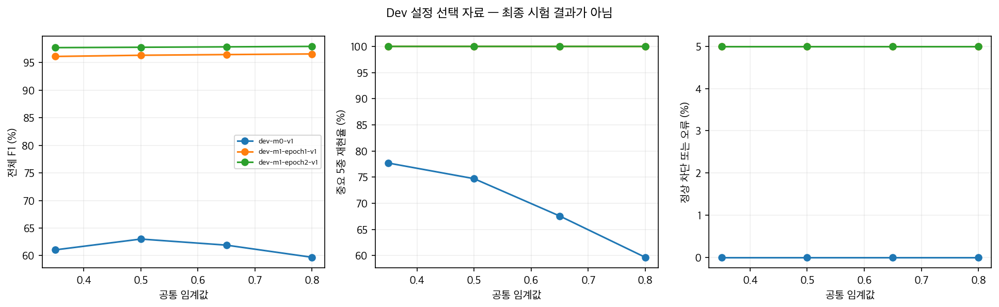

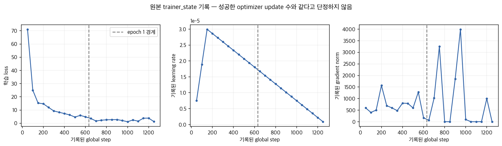

### 5.2 동결 서비스 최종 시험 (300건)

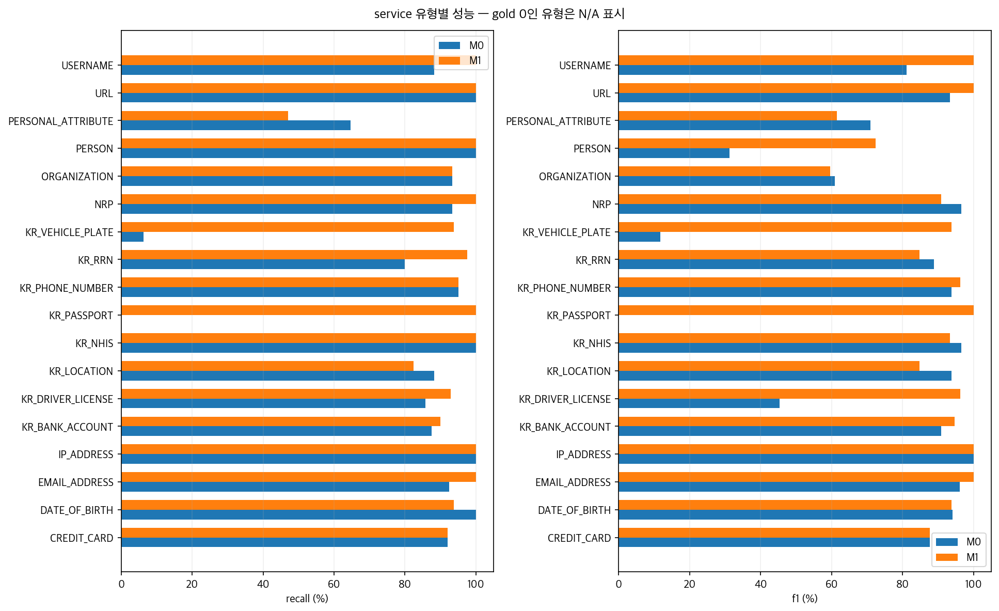

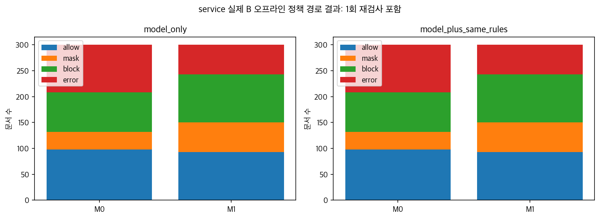

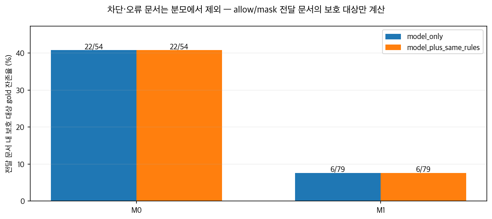

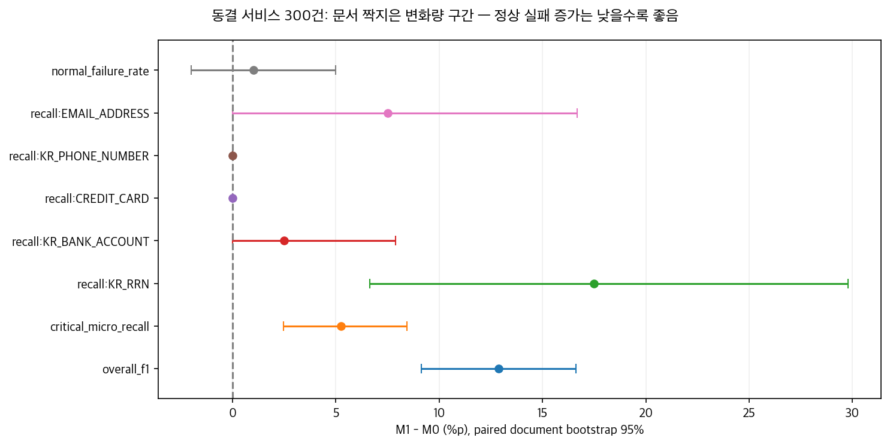

### 5.3 공식 Test 최종 시험 (`test_track_a`, 28,142건)

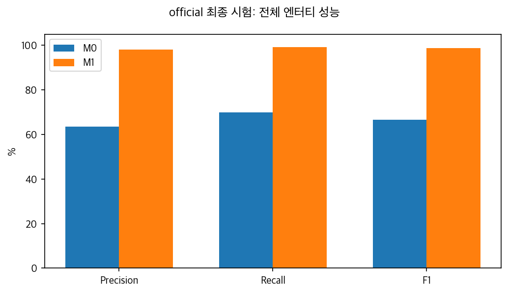

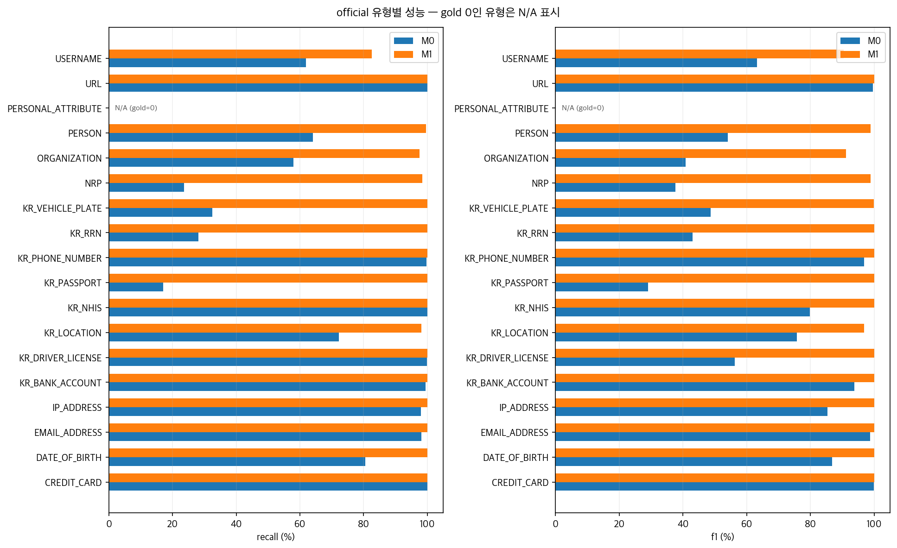

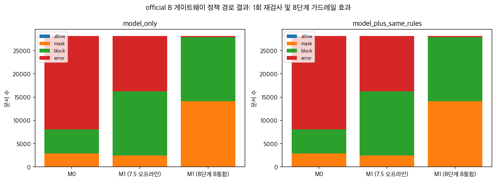

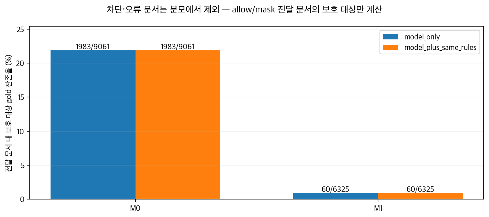

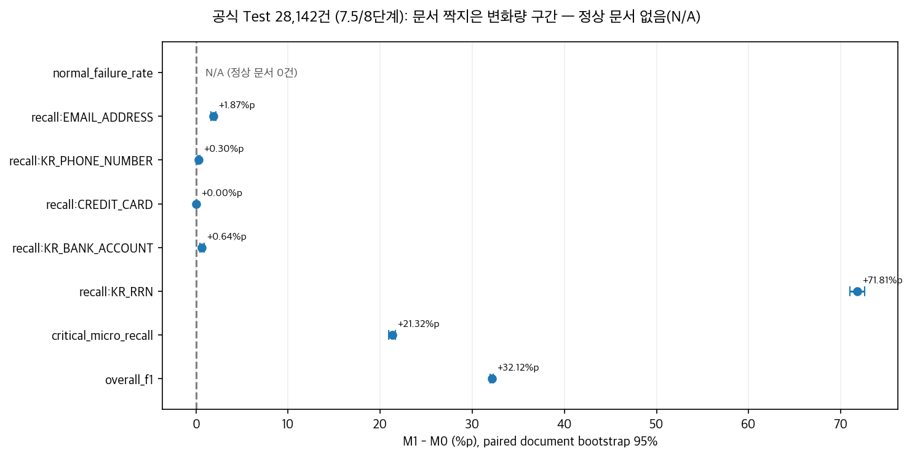

학습 표본의 분야·유형 분포([`sample-domains.png`](graph/sample-domains.png), [`sample-labels.png`](graph/sample-labels.png)), 정상 문서 실패율 Wilson 구간([`service-normal-failure.png`](graph/service-normal-failure.png), [`official-normal-failure.png`](graph/official-normal-failure.png)), 오프라인 지연 누적분포([`service-latency.png`](graph/service-latency.png), [`official-latency.png`](graph/official-latency.png))도 [`model/graph/`](graph/README.md)에서 확인할 수 있습니다.

---

## 6. 단계별 핵심 트러블슈팅 이력 및 해결 아키텍처

단순히 학습을 돌려 점수를 낸 것이 아니라, 1~7.5단계 전 과정에서 발생한 **데이터 손실·추론 분할 불일치·미완료 검사 은폐·창 경계 파편화·가설 기각** 등 5대 핵심 문제를 코드와 실측으로 규명·해결했습니다.

| 단계 · 문제 구간 | 발생 현상 및 최초 원인 | 해결 방법 및 검증 결과 | 상세 근거 문서 |
|---|---|---|---|
| **① 3단계: 한국어 조사 결합으로 인한 학습 데이터 `98.9%` 거절** | B 기본 공백/알파벳 분할기(`default_gliner_words_splitter`)가 `김가상에게`를 한 단어로 묶어, 어절 내부의 `김가상` 스팬을 단어 경계로 표현할 수 없어 `train` 243,711건 중 **2,615건(`1.07%`)만 변환**됨 | 원문만 보고 결정론적으로 분리하는 순수 분할기 `v1 → v2(201,274건, URL 손실) → ko_atomic_suffix_v3`를 설계해 **`236,900/243,711건(97.21%)` 변환 및 18개 전 유형 보존** 달성 | [segmentation/README.md](segmentation/README.md), [conversion-summary.md](reports/conversion-summary.md), [segmentation-diagnosis-v2.json](reports/segmentation-diagnosis-v2.json) |
| **② 7→7.5단계: 학습·추론 분할기 불일치로 인한 초기 M1 `reject`** | 6단계 학습 데이터는 `ko_atomic_suffix_v3`로 변환했으나, 7단계 추론 시 GLiNER 내부 `data_processor.words_splitter`에는 기본 분할기가 그대로 남아 **서비스 F1 `58.31%`, 계좌(`-1.89%p`)·카드(`-12.20%p`) 역전 및 정상 오차단 `8/100`(`reject`)** 발생 | [`attach_words_splitter()`](segmentation/runtime.py)로 GLiNER 런타임 내부 `words_splitter`와 창 계획에 `ko_atomic_suffix_v3`를 동일 주입하고 새 프로세스 재로딩 검증 통과 → **동결 서비스 F1 `89.38%`, 공식 Test F1 `98.70%`, 중요 5종 퇴행 `0건`**으로 해결 | [stage7-review-v1.md](reports/stage7-review-v1.md), [stage7_5-gpu-smoke-v1.json](reports/stage7_5-gpu-smoke-v1.json), [m1-training-summary.md](reports/m1-training-summary.md) |
| **③ 7.5단계: 미완료(`incomplete`) 조용한 통과 결함 및 40번째 장문 창 경계 불일치** | 기존 실행기가 `result.status != "complete"`인 문서를 에러 없이 빈 탐지(`findings=[]`)로 채점하던 버그 발견. 수정 후 첫 서비스 실행(`v4`) 시 **40번째 장문 문서에서 384단어 창 경계에 걸친 한국어 어절의 조사 분할이 전체 문장 분할과 달라져 `incomplete`로 안전 중단**됨 | 미완료 문서를 즉시 `failed.json`으로 격리하도록 수정하고, 전체 문장 원자 단어 경계를 보존해 창을 자르는 [`BoundarySafeCoverageBackend`](segmentation/coverage_backend.py)를 구현 → **서비스 `300/300건`, 공식 Test `28,142/28,142건` 전량 `complete`(`incomplete=0`)** 완주 | [stage7_5-coverage-audit-v1.json](reports/stage7_5-coverage-audit-v1.json), [coverage_backend.py](segmentation/coverage_backend.py), [runner.py](evaluation/runner.py) |
| **④ 7.5단계: 서비스 시험셋(`v1 → v2 → v2-r2`) 오염 방지 및 라벨 전수 교정** | 초기 `service-test-v1`(300건)은 사람 검토·동결 전에 모델 점수를 먼저 확인해 최종 시험 자격을 상실했고, 새로 만든 `v2` 초안에서도 인접 조사 포함·부분 스팬·자연스럽지 않은 템플릿 문제가 발견됨 | `v1`은 회귀용으로 격리하고, 사용자 피드백을 전수 반영해 `service-holdout-v2-r2`(300건)의 오프셋·경계·정상 문서를 교정한 뒤 **최종 평가 전에 해시 동결** | [holdout-v2-review-response.md](reports/holdout-v2-review-response.md), [service-holdout-v2-r2.frozen.manifest.json](evaluation/service-holdout-v2-r2.frozen.manifest.json) |
| **⑤ 7.5단계: “임계값 상향으로 오차단 해결” 가설 기각 및 `REINSPECTION_FAILED` 원인 규명** | 초기 보고서에서 “임계값을 `0.65~0.7`로 올리면 정상 오차단이 `1%` 이하로 해결된다”고 가정했으나 검증되지 않았고, 게이트웨이 `error` 다수 발생 원인이 불명확했음 | Dev 28,347건 그리드 탐색(`0.35~0.8`)으로 **자산코드·13~16자리 정수열이 `KR_RRN` 점수 `>0.8~1.0`을 받아 임계값 상향만으로 해결되지 않음(`10/200`)**을 실측 입증하고, 게이트웨이 `error`가 런타임 크래시가 아닌 **마스킹 후 2차 재검사(`REINSPECTION_FAILED`) 정책 차단**임을 전수 추적으로 규명 | [stage7_5-selection-v1.json](reports/stage7_5-selection-v1.json), [stage7_5-service-final-v1.json](reports/stage7_5-service-final-v1.json), [stage7_5-official-final-v1.json](reports/stage7_5-official-final-v1.json) |

---

## 7. 남아 있는 한계와 8단계(B 파트 인계·운영 인수 및 후속 고도화) 체크리스트

### 7.1 현재 남아 있는 한계
- 기존 학습 표본(`train_5k.jsonl`)은 앞 5,000건 순차 추출 표본(고유 4,996건)이며, 새로 준비한 12분야 균형 5,000건 표본([stage7_5-sample-v1.json](reports/stage7_5-sample-v1.json))과 정상 음성 예시를 반영한 추가 학습은 아직 수행하지 않았습니다.
- 동결 서비스 시험에서 중요 5종은 퇴행이 없으나, `DATE_OF_BIRTH`·`KR_LOCATION`·`PERSONAL_ATTRIBUTE`·`USERNAME` 등 일부 비핵심 유형의 재현율 저하와 정상 숫자 유사 문서 오차단(`2/100`, 허용 상한 경계)이 남아 있습니다.
- 오프라인 지연 시간(공식 Test `p95 49.67ms`, 서비스 시험 `p95 94.54ms`)은 서버 내부 추론+정책+1회 재검사 시간이며, 네트워크 왕복과 B 클라이언트 종단간 p95(`500ms` 목표) 인수 증거를 대체하지 않습니다.

### 7.2 8단계 상세 체크리스트 (B 인계·운영 인수 및 추가 포함 권장 과제)

8단계에서는 단순 가중치 전달을 넘어, 7.5단계에서 규명한 운영 리스크를 안전하게 제어하기 위해 아래 6개 트랙을 수행합니다.

- [ ] **8-1. 모델 패키지 계약(`model-package.schema.json`) 번들링 및 즉시 롤백(M0) 구성**
  - M1 최종 선택본(`checkpoint-1262`, `model.safetensors` SHA-256 `ed2546b8b6a721be18a6a9e644fe6fd423016c7a457b5e30521d85c3d86228a2`), 토크나이저, 18종 라벨 매핑, 공통 임계값(`0.5`), 창 설정(`max_words=384, overlap=64, max_span=12, max_subtokens=512`), 전처리 버전(`preprocessing.version = "ko_atomic_suffix_v3"`), 라이선스·평가 레코드를 [`dev/contracts/model-package.schema.json`](../dev/contracts/model-package.schema.json) 규격의 매니페스트로 패키징합니다.
  - 운영 중 이상 징후 발생 시 환경 변수 또는 설정 스위치 하나로 즉시 고정 M0 패키지(`49a065fb...`)로 복구(Rollback)하는 절차를 B와 함께 검증합니다.
- [ ] **8-2. B 운영 런타임 분할기(`ko_atomic_suffix_v3`) 및 경계 안전 창 처리(`BoundarySafeCoverageBackend`) 이관 (`b_splitter_adoption`)**
  - B의 [`dev/detector/gliner_backend.py`](../dev/detector/gliner_backend.py)가 추론 시 [`attach_words_splitter()`](segmentation/runtime.py)와 [`BoundarySafeCoverageBackend`](segmentation/coverage_backend.py)의 원자 어절 경계 창 분할을 동일하게 사용하도록 통합합니다.
  - 40번째 서비스 장문 문서 등 384단어 경계 어절 회귀 테스트를 B 런타임 테스트 스위트에 추가하여 `incomplete=0`을 보장합니다.
- [ ] **8-3. 숫자 유사 정상 문서(`numeric_lookalikes` → `KR_RRN`) 오차단 방어 가드레일 및 M1.1 보완 실험**
  - **단기(B 정책/후처리 가드레일)**: 장비 자산코드(`EQ-2026-314159` 등 영문 접두·하이픈 결합 코드)나 13~16자리 일반 정수열이 `KR_RRN`으로 오탐되어 즉시 `block`되는 현상(`서비스 2/100`, `Dev 조정 10/200`)을 줄이기 위해, `KR_RRN` 판정 시 6+7자리(생년월일 유효 월/일 + 성별코드 `1~8`) 형식·체크섬 보조 검증 또는 문맥 화이트리스트를 B 후처리/정책 단계에 적용하는 방안을 검증합니다.
  - **중기(M1.1 재학습 트랙)**: 이미 구축해 둔 12개 분야 균형 5,000건 표본([stage7_5-sample-v1.json](reports/stage7_5-sample-v1.json))에 숫자 유사 정상 문서(음성 예시)를 혼합하여 재학습한 뒤 동일 동결 기준으로 비교합니다.
- [ ] **8-4. 마스킹 후 1회 재검사 실패(`REINSPECTION_FAILED` → `error`) 운영 정책 정교화**
  - 1차 `mask` 판정 문서가 `[MASKED]` 치환 후 2차 재검사에서 플레이스홀더 주변 문맥 재탐지 등으로 인해 `REINSPECTION_FAILED`(`error`)로 다수 전환되는 현상(`서비스 57/300`, `공식 Test 11,921/28,142`)을 완화하기 위해, B와 함께 ① 이미 마스킹된 플레이스홀더 구간(`decision.segments`)을 2차 오탐 판정에서 제외하거나, ② 치환 문자열 형식을 모델 친화적으로 조정하는 정책 개선을 검토합니다.
- [ ] **8-5. 비핵심 마스킹 유형(`PERSONAL_ATTRIBUTE`, `KR_LOCATION`, `USERNAME`) 보완 로드맵**
  - K-PII-Bench 원본에 정답이 0건이어서 서비스 시험 전달 문서 잔존(`6건` 중 `4건`)의 주원인이 된 `PERSONAL_ATTRIBUTE`(직함·부서·개인속성)에 대해 소규모 보충 학습 데이터 또는 사전/규칙 보조 탐지를 설계하고, 도로명 주소 뒤 동·호수 접미부(`KR_LOCATION`) 스팬 경계 결합 규칙을 보완합니다.
- [ ] **8-6. B 종단간 런타임 인수 시험(`runtime_acceptance`) 및 C 감사 로그·카나리 배포 검증**
  - 실제 서빙 환경에서 예열 후 동시성 1·2,000 코드포인트 이내 클라이언트 측 종단간 **p95 ≤ 500ms/회** 지연 시간, GPU/CPU 메모리 상한, 장애 시 fail-closed 복구, C 파트의 비식별 감사 저널(`dev/gateway/journal.py` — 원문 미저장·해시/유형/위치만 기록) 연동을 통합 검증합니다.
  - 초기 배포 시 M0를 기본 차단/허용 기준으로 두고 M1을 Shadow/Canary 모드로 병행 비교한 뒤 이상이 없을 때 `runtime_acceptance=True`로 전환합니다.

로컬 회귀 테스트는 `model/.cache/conversion-venv/bin/python -m pytest model/tests -q`로 검증합니다. 원문 데이터·문서별 예측·가중치·접속정보는 Git 제외 캐시(`model/.cache/`, `model/.secrets/`)에만 보관합니다.
